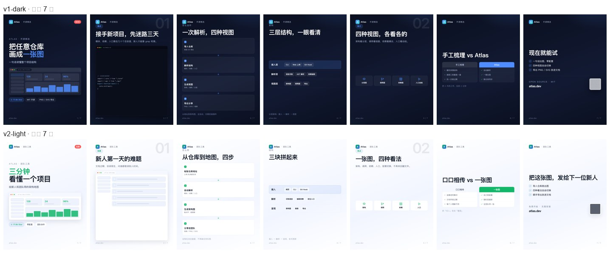
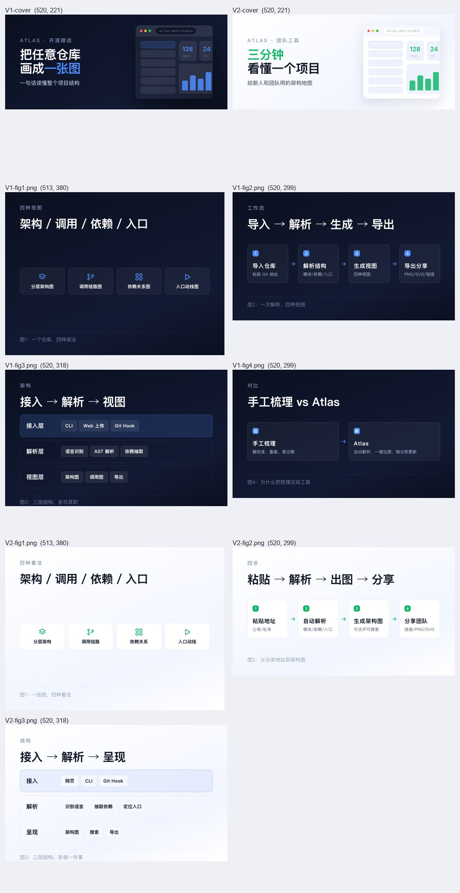

# wechat-mp · WeChat Official Account Content Studio (Agent Skill)

[](LICENSE)
[](https://nodejs.org/)
[](https://github.com/v5note/wechat-mp/stargazers)
[](https://github.com/v5note/wechat-mp/pulls)

**Turn any topic into publish-ready WeChat content**: image-card series + long-form articles — **2 versions × 2 formats = 4 samples**.
Every image follows the same **image design system**, every article follows the same **article format spec** — stable, reproducible, no improvisation.

> This is an **Agent Skill**. Install it into your AI Agent and say "turn this topic into WeChat content", and it will produce deliverables according to the specs in this repo.

[简体中文](README.md) · [Demo output](examples/demo/)

---





---

## Table of Contents

- [Introduction](#introduction)
- [Features](#features)
- [What One Run Produces](#what-one-run-produces)
- [Demo](#demo)
- [Installation](#installation)
  - [Option 1: Command-line install](#option-1-command-line-install)
  - [Option 2: Paste one sentence to your Agent](#option-2-paste-one-sentence-to-your-agent)
- [Usage](#usage)
  - [Quick start](#quick-start)
  - [Standard workflow](#standard-workflow)
  - [Use your own topic](#use-your-own-topic)
- [spec.json Reference](#specjson-reference)
- [Project Structure](#project-structure)
- [Requirements](#requirements)
- [Specs & Playbooks](#specs--playbooks)
- [FAQ](#faq)
- [License](#license)

---

## Introduction

`wechat-mp` is a **content-production toolchain + Agent skill** for WeChat Official Accounts. Given a topic, project, tutorial, or data review, it produces a complete set of ready-to-upload deliverables:

- **Image cards (image message / Xiaolüshu)**: 5–9 cards at 3:4 aspect ratio + a per-image caption script.
- **Article (rich-text long read)**: a ≥800-character article + cover + in-body figures (inline-styled HTML + Markdown).

The core idea is **"specs first, then scripts render"**:

- Copywriting formulas (titles / summaries / leads / CTAs) — [content-playbook](references/content-playbook.md).
- A visual design system (sizes / grid / safe area / themes / type scale / icons) — [image-design-system](references/image-design-system.md).
- Formatting rules for WeChat (typography params / structure / inline HTML) — [article-format](references/article-format.md).
- All images are rendered from HTML templates via headless Chrome into PNGs — controlled specs, reproducible results.

As a result, the output stays stylistically consistent no matter who or when generates it; the two versions differ only in **visual theme and tone**, never in facts, so you can A/B them easily.

## Features

- ✅ **Four samples in one run**: 2 versions (Dark Tech / Light Clean) × 2 formats (cards / article) = 4 samples.
- ✅ **Content separated from layout**: change one `spec.json` to regenerate everything; copy and images share one source.
- ✅ **Controlled specs**: cards fixed at 1080×1440 (3:4), cover 1080×460 (2.35:1), in-body figures 1080 wide.
- ✅ **WeChat paste-ready**: article HTML uses inline styles only — no external CSS or scripts — so pasting keeps the styling.
- ✅ **Built-in visual components**: browser frame, code window, flow diagram, layered diagram, icon tiles, comparison card, and more.
- ✅ **Zero extra dependencies**: only Node.js 18+ and a local Chrome / Chromium; no npm packages.
- ✅ **Delivery self-check**: every sample ships with a copy deck (`文案.md`) and a publish checklist (`发布清单.md`).

## What One Run Produces

**2 versions × 2 formats = 4 WeChat samples**:

| Version | Cards (image message / Xiaolüshu) | Article (rich-text long read) |
|---|---|---|
| V1 Dark Tech | 5–9 cards at 3:4 + caption script | Long read + cover + 3–5 figures |
| V2 Light Clean | 5–9 cards at 3:4 + caption script | Long read + cover + 3–5 figures |

Each sample ships four parts:

1. **Title options**: 3–5 for the article, 2–3 for the cards (≤20 chars), with a recommended pick marked.
2. **Summary**: article summary ≤54 chars (WeChat share-card limit); a ≤100-char description for the cards.
3. **Body**: Markdown + WeChat-pasteable HTML for the article; a per-image caption script for the cards.
4. **Figures / publish checklist**: figure captions, image specs, and an itemized checklist you can tick off.

## Demo

The repo ships one complete demonstration (the "Atlas" topic is fictional demo data) under [examples/demo/](examples/demo/):

| # | Sample | Content |
|---|---|---|
| 1 | V1 Dark Tech · cards | 7 cards at 3:4 → [cards](examples/demo/v1-dark/cards/) |
| 2 | V1 Dark Tech · article | 1,736-char article + cover + 4 figures → [article.md](examples/demo/v1-dark/article/article.md) |
| 3 | V2 Light Clean · cards | 7 cards at 3:4 → [cards](examples/demo/v2-light/cards/) |
| 4 | V2 Light Clean · article | 876-char article + cover + 3 figures → [article.md](examples/demo/v2-light/article/article.md) |

See [examples/demo/README.md](examples/demo/README.md) for details and reproduce commands.

## Installation

### Option 1: Command-line install

Place this repo into your Agent's skills directory — **the directory name is the skill name** (`wechat-mp`).

```bash
# Clone into the skills directory
mkdir -p ~/.agents/skills
git clone https://github.com/v5note/wechat-mp.git ~/.agents/skills/wechat-mp

# Or, if you already have a local checkout, just symlink it
ln -s "$(pwd)" ~/.agents/skills/wechat-mp
```

> Adjust the skills-directory path to whatever your Agent actually uses.

### Option 2: Paste one sentence to your Agent

Send the following sentence to your AI Agent:

> Please install the `wechat-mp` skill: clone `https://github.com/v5note/wechat-mp.git` into `~/.agents/skills/wechat-mp`, then start a new session.

After installing, open a **new session** and say "use wechat-mp to turn this topic into WeChat content".

## Usage

### Quick start

Render a single image (HTML → PNG):

```bash
node scripts/render.mjs --in templates/card.html --out out.png --width 1080 --height 1440
```

Build a full set from a spec (cards + cover + figures + copy + publish checklist):

```bash
node scripts/build.mjs --spec examples/demo/v1-dark.spec.json  --out examples/demo/v1-dark
node scripts/build.mjs --spec examples/demo/v2-light.spec.json --out examples/demo/v2-light
```

Each version folder contains:

```text
v1-dark/
├── cards/                 card-01.png … card-07.png   (image cards, 1080×1440)
├── article/
│   ├── cover.png          (article cover, 1080×460)
│   ├── images/fig1..N.png (in-body figures, ≥3)
│   ├── article.md         (Markdown body)
│   └── article.html       (WeChat-pasteable inline-styled HTML)
├── 文案.md                (title options · summary · per-image caption script)
├── 发布清单.md            (image count / order / captions / upload checks)
├── index.md               (index for this version)
└── *.spec.json            (content source — edit to reproduce / iterate)
```

### Standard workflow

When handing a topic to your Agent (or doing it yourself), follow these 7 steps:

1. **Brief** — distill topic, audience, positioning, selling points, brand/column, tone differences, and content genre.
2. **Layout** — decide the card sequence, article outline, and dark/light theme tokens.
3. **Copy** — title options, ≤54-char summary, article Markdown draft, and per-card caption script.
4. **Images** — render HTML templates into PNGs and visually check safe area / line breaks / overlaps.
5. **Article formatting** — produce inline-styled HTML + matching Markdown, with complete figure captions.
6. **Publish checklist** — generate an itemized checklist per [publish-checklist](references/publish-checklist.md).
7. **Self-check** — verify sizes, character counts, captions, version differences, and that all four samples are complete.

See [SKILL.md](SKILL.md) for the full contract.

### Use your own topic

Open any `spec.json` and edit these areas to regenerate everything:

- `name` / `brand` / `accent` / `accent2` — project name, brand, and the two accent colors.
- `titles` / `summary` / `imageCaption` — title options, summary, and card caption.
- `cards[]` — each card's title, body, and visual component.
- `article.*` — article title, lead, table of contents, sections, and figure slots.

Images will be regenerated against the same design system. See [templates/README.md](templates/README.md) for details.

## spec.json Reference

| Field | Meaning |
|---|---|
| `theme` | `dark` (Dark Tech) or `light` (Light Clean) |
| `accent` / `accent2` | theme accent colors |
| `brand` | `{ name, logo, column, site }` |
| `titles` | `{ article[], image[], recommend }` |
| `summary` / `imageCaption` | article summary / card caption |
| `cards[]` | the card series |
| `article` | article structure (cover / toc / lead / sections[] / closing / links / cta) |

**Card variants**: `cover`, `point`, `diagram`, `compare`, `ending`.

**Hero visual components**: `browser`, `code`, `flow` (flowchart), `stack` (layers), `tiles` (icon grid), `ring`.

See [assets/icons/README.md](assets/icons/README.md) for the icon list.

## Project Structure

```text
wechat-mp/
├── SKILL.md               # Skill entry: triggers, output contract, workflow, hard rules
├── assets/
│   ├── tokens.css         # Dark & light theme tokens (colors / type / spacing)
│   ├── icons.svg          # Icon sprite
│   └── icons/README.md    # Icon usage & list
├── templates/
│   ├── card.html          # Card shell (1080×1440)
│   ├── article-cover.html # Article cover (1080×460)
│   ├── diagram.html       # In-body figure (1080 wide, custom height)
│   ├── article-body.html  # Inline-style recipe reference for WeChat
│   └── README.md          # Template placeholders & card data reference
├── scripts/
│   ├── render.mjs         # HTML → PNG (headless Chrome)
│   ├── build.mjs          # Batch-build a full set from spec.json
│   ├── chrome.mjs         # Chrome detection + asset injection
│   ├── visuals.mjs        # Card / visual component library
│   └── article.mjs        # Article Markdown / HTML generation
├── references/            # The four specs & playbooks
└── examples/demo/         # Two-version, four-sample demo output
```

## Requirements

- **Node.js 18+** (scripts use ES Modules; no npm dependencies).
- **Chrome or Chromium** (macOS / Linux). Scripts auto-detect common paths; you can also specify one manually:

```bash
export CHROME_BIN="/Applications/Google Chrome.app/Contents/MacOS/Google Chrome"
```

## Specs & Playbooks

| Doc | Content |
|---|---|
| [image-design-system.md](references/image-design-system.md) | Image design system: sizes / grid / safe area / theme tokens / type scale / 5 card types / icons / do & don't |
| [article-format.md](references/article-format.md) | Article format spec: WeChat typography / structure / four genres / inline HTML rules |
| [content-playbook.md](references/content-playbook.md) | Copywriting formulas: titles / summaries / leads / CTAs / four genre outlines |
| [publish-checklist.md](references/publish-checklist.md) | Publish checklist + pre-delivery self-check |

## FAQ

**Q: Can I publish or commercialize the generated images?**
A: The copy and data come from you; the templates and scripts belong to this repo. Use them under this repo's License, and review content compliance yourself before publishing.

**Q: What if I don't have Chrome?**
A: Install Chrome / Chromium, or point `CHROME_BIN` at any Chromium-based browser.

**Q: How do I add a new card type or visual component?**
A: Follow "Adding a new card" in [templates/README.md](templates/README.md): add a builder in `visuals.mjs` → register the variant in `buildCard()` → document it in `image-design-system.md`.

**Q: Why are the cards 1080×1440?**
A: 3:4 is a well-adapted ratio for WeChat image messages and Xiaolüshu — portrait layout displays more completely. See [image-design-system.md](references/image-design-system.md).

## License

This project is released under the [MIT License](LICENSE). The "Atlas" project and all data in the demo output are fictional.

