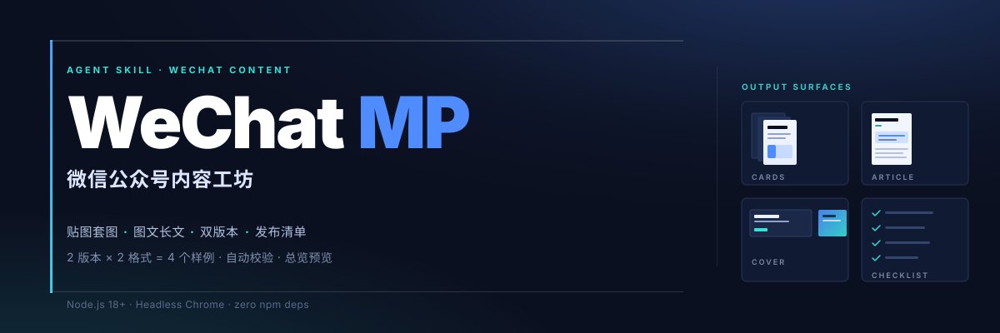
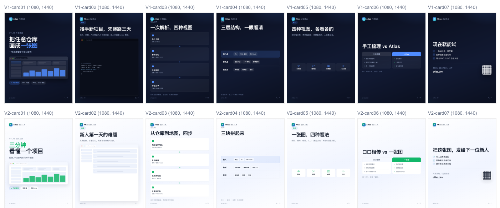
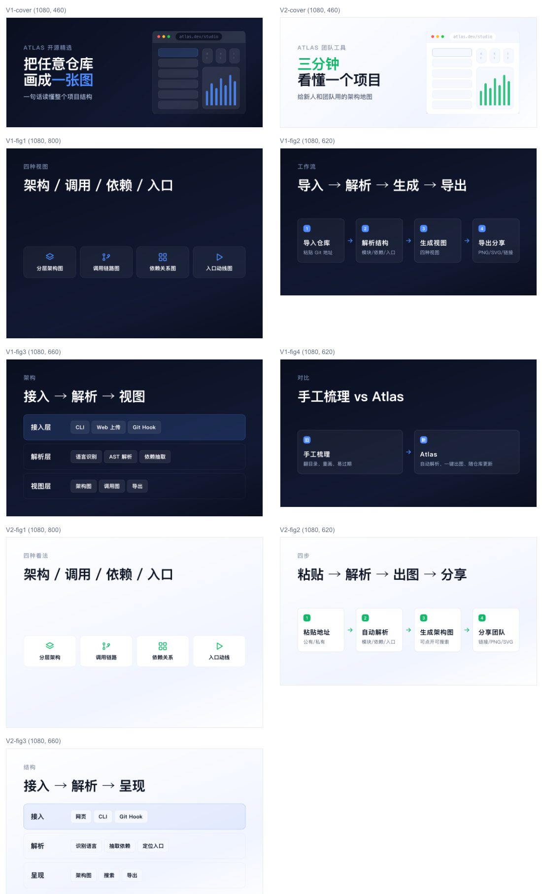
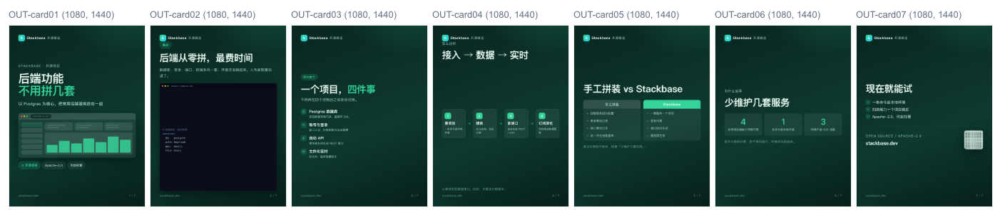
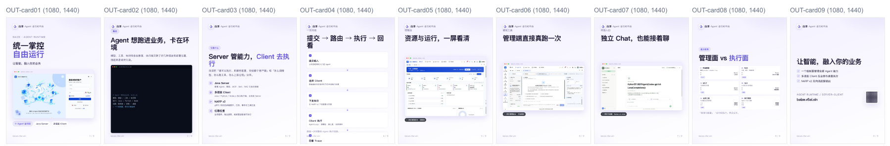
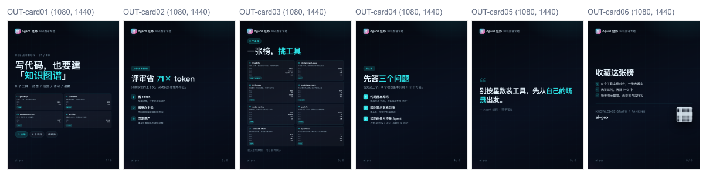
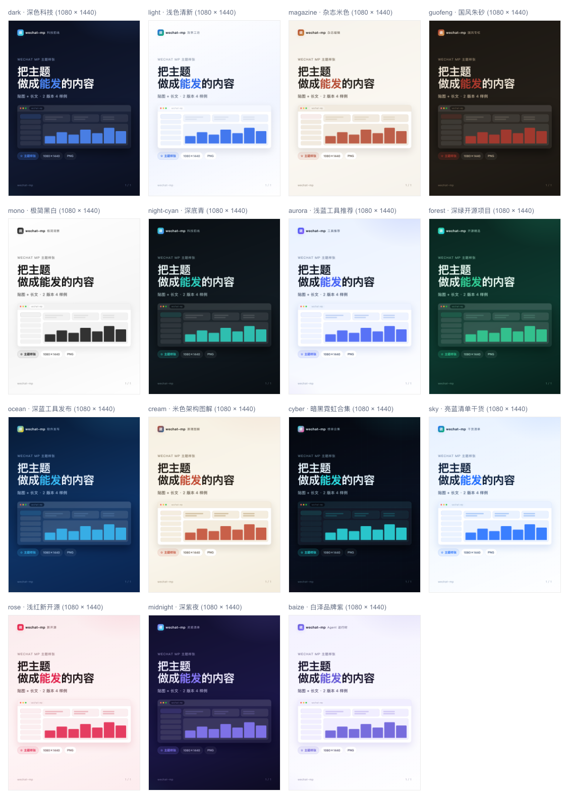

# wechat-mp · 微信公众号内容工坊（Agent Skill）

[](LICENSE)
[](https://nodejs.org/)
[](https://github.com/v5note/wechat-mp/stargazers)
[](https://github.com/v5note/wechat-mp/pulls)



**把一个主题做成「能直接发」的公众号内容**：贴图套图 + 图文长文（+ 可选视频号），**默认 2 个版本 × 2 种格式 = 4 个样例**。
内置 **15 套参考风格主题**与**体裁智能路由**（从 35 张贴图、15 篇文章、3 个视频号素材提炼），所有配图走同一套**图片设计规范**，
所有长文走同一套**文章格式规范**——风格稳定、可复现，不靠临场发挥。

> 这是一个 **Agent Skill**。把它装进你的 AI Agent，说一句「把这个主题做成公众号」，它就会按本仓库的规范产出成品。

[English](README.en.md) · [示例产出](examples/demo/) · [风格案例](examples/cases/)

---





---

## 目录

- [介绍](#介绍)
- [特性](#特性)
- [一次调用产出什么](#一次调用产出什么)
- [演示](#演示)
- [安装](#安装)
  - [方式一：命令行安装](#方式一命令行安装)
  - [方式二：粘贴一句话给 Agent 安装](#方式二粘贴一句话给-agent-安装)
- [如何使用](#如何使用)
  - [快速开始](#快速开始)
  - [标准工作流](#标准工作流)
  - [换成你自己的主题](#换成你自己的主题)
- [spec.json 速查](#specjson-速查)
- [目录结构](#目录结构)
- [环境要求](#环境要求)
- [规范文档](#规范文档)
- [常见问题](#常见问题)
- [License](#license)

---

## 介绍

`wechat-mp` 是一套面向微信公众号的**内容生产工具链 + Agent 技能**。给定一个主题、项目、教程或数据复盘，它产出一整套可直接上传的成品：

- **贴图（图片消息 / 小绿书）**：3:4 卡片图 5–9 张 + 逐图文案脚本。
- **文章（图文消息长文）**：≥800 字的深度长文 + 封面 + 正文配图（内联样式 HTML + Markdown 双格式）。

核心思路是「**规范先行，脚本出图**」：

- 文案有公式（标题 / 摘要 / 导语 / CTA），见 [content-playbook](references/content-playbook.md)。
- 版式有设计系统（尺寸 / 栅格 / 安全区 / 主题 / 字号 / 图标），见 [image-design-system](references/image-design-system.md)。
- 排版有格式规范（微信排版参数 / 结构 / 内联 HTML），见 [article-format](references/article-format.md)。
- 配图全部由 HTML 模板 + 无头 Chrome 渲染成 PNG，规格受控、可复现。

因此，同一主题换个人、换个时间生成，出来的风格也保持一致；两版只换**视觉主题与语气**，不换事实，方便 A/B 选型。

## 特性

- ✅ **一键四样例**：2 版本（深色科技版 / 浅色清新版）× 2 格式（贴图 / 文章）= 4 个公众号样例。
- ✅ **风格库 + 智能路由**：15 套主题（深色/浅绿/深蓝/米色/霓虹/亮蓝/浅红…）× 11 种贴图风格 × 6 种文章骨架，按题材自动推荐，见 [style-catalog](references/style-catalog.md)。
- ✅ **可选视频号产出**：`spec.video` 生成竖版封面（1080×1920）+ 口播稿 + 分镜表，见 [video-format](references/video-format.md)。
- ✅ **内容与版式分离**：改一个 `spec.json` 即可整体重出，文案与图片同源。
- ✅ **规格受控**：贴图固定 1080×1440（3:4），封面 1080×460（2.35:1）+ 1:1 方版 1080×1080，正文配图宽 1080。
- ✅ **微信可直接粘贴**：文章 HTML 只用内联样式，无外链 CSS / 脚本，粘贴不丢样式。
- ✅ **自动校验 + 预览**：`check.mjs` 检查尺寸/字数/图片引用/图注/md-html 同源，`preview.mjs` 生成总览图，坏产物不交付。
- ✅ **内置视觉组件**：浏览器框、代码窗、流程图、编号步骤、分层图、图标卡、字段卡片墙、勾选清单、数据大字、真实截图框等，开箱即用。
- ✅ **真实产品案例**：支持 `shot` 真实截图与 `logoImg` 品牌 logo；白泽案例使用官方 logo 与真实管理后台截图。
- ✅ **零额外依赖**：仅需 Node.js 18+ 与本机 Chrome / Chromium，不装任何 npm 包。
- ✅ **交付自检**：每个样例附带「文案.md」与「发布清单.md」，照单执行即可上线。

## 一次调用产出什么

**2 个版本 × 2 种格式 = 4 个公众号样例**：

| 版本 | 贴图（图片消息 / 小绿书） | 文章（图文消息长文） |
|---|---|---|
| V1 深色科技版 | 5–9 张 3:4 卡片图 + 逐图文案 | 长文 + 封面 + 3–5 张正文配图 |
| V2 浅色清新版 | 5–9 张 3:4 卡片图 + 逐图文案 | 长文 + 封面 + 3–5 张正文配图 |

**进阶**：按风格库显式挑 1 套「主题 + 骨架」做高完成度单样例；需要时再加 1 个视频号产出（可单独发视频号）。

每个样例都带齐四件套：

1. **标题备选**：文章 3–5 条、贴图 2–3 条（≤20 字），标注推荐项。
2. **摘要**：文章摘要 ≤54 字（微信分享卡片上限）；贴图写一段 ≤100 字配文。
3. **正文**：文章给 Markdown 正文 + 微信可粘贴 HTML；贴图给逐图文案脚本。
4. **配图 / 发布清单**：图注、图片规格、以及逐项可打勾的发布清单。

## 演示

仓库内置一套完整示范（主题「Atlas」为演示虚构数据），见 [examples/demo/](examples/demo/)：

| # | 样例 | 内容 |
|---|---|---|
| 1 | V1 深色科技版 · 贴图 | 7 张 3:4 卡片 → [cards](examples/demo/v1-dark/cards/) |
| 2 | V1 深色科技版 · 文章 | 1738 字长文 + 封面 + 4 张配图 → [article.md](examples/demo/v1-dark/article/article.md) |
| 3 | V2 浅色清新版 · 贴图 | 7 张 3:4 卡片 → [cards](examples/demo/v2-light/cards/) |
| 4 | V2 浅色清新版 · 文章 | 878 字长文 + 封面 + 3 张配图 → [article.md](examples/demo/v2-light/article/article.md) |

演示详情与复现命令见 [examples/demo/README.md](examples/demo/README.md)。

### 参考风格案例

从上面的参考素材提炼风格后，仓库另附 5 个高完成度案例（除白泽为真实产品外，其余为演示虚构项目，用于展示版式与写法）：

| 案例 | 风格 | 体裁 | 产出 |
|---|---|---|---|
| [forest-stackbase](examples/cases/forest-stackbase/) | 深绿开源项目（forest） | 开源项目推荐 | 7 张贴图 + 1065 字文章 + 视频号（口播稿/分镜/封面） |
| [rose-mosaic](examples/cases/rose-mosaic/) | 浅红新开源（rose） | 设计干货 | 6 张贴图 + 895 字文章 + 视频号（图文轮播脚本） |
| [cream-agent](examples/cases/cream-agent/) | 米色架构图解（cream） | 原理图解 | 6 张贴图 + 937 字文章 |
| [baize-baize](examples/cases/baize-baize/) | 白泽品牌紫（baize，**真实产品**） | Agent 运行时推荐 | 9 张贴图（真实后台截图）+ 1465 字文章 + 视频号 |
| [cyber-agentbench](examples/cases/cyber-agentbench/) | 暗黑霓虹合集（cyber） | 合集 / 榜单 | 6 张贴图 + 928 字文章 + 视频号 |





### 可选增强：风格样张与方向提案



**这些是可选增强，不跑也能正常产出两版四样例。** 15 套主题样张由 `node scripts/gen-specimens.mjs` 真实渲染生成；三方向提案示例见 [directions.png](examples/demo/directions/directions.png)，半自动生成示例见 [directions-auto/directions.png](examples/demo/directions-auto/directions.png)。

## 安装

### 方式一：命令行安装

把本仓库放到 Agent 的技能目录，**目录名即技能名**（`wechat-mp`）。

```bash
# 克隆到技能目录
mkdir -p ~/.agents/skills
git clone https://github.com/v5note/wechat-mp.git ~/.agents/skills/wechat-mp

# 或者：本地已有代码，直接软链
ln -s "$(pwd)" ~/.agents/skills/wechat-mp
```

> 技能目录路径请以你所用 Agent 的实际约定为准。

### 方式二：粘贴一句话给 Agent 安装

直接把下面这句话发给你的 AI Agent：

> 请安装 `wechat-mp` 技能：把 `https://github.com/v5note/wechat-mp.git` 克隆到 `~/.agents/skills/wechat-mp`，然后新开一轮会话。

安装完成后，在**新会话**里说「用 wechat-mp 把这个主题做成公众号」即可。

## 如何使用

### 快速开始

渲染单张图（HTML → PNG）：

```bash
node scripts/render.mjs --in templates/card.html --out out.png --width 1080 --height 1440
```

按 spec 批量出整套（卡片 + 封面 + 配图 + 文案 + 发布清单）：

```bash
node scripts/build.mjs --spec examples/demo/v1-dark.spec.json  --out examples/demo/v1-dark
node scripts/build.mjs --spec examples/demo/v2-light.spec.json --out examples/demo/v2-light
```

（可选增强）生成全部 15 套主题样张 / 三方向提案：

```bash
node scripts/gen-specimens.mjs
node scripts/directions.mjs --topic "Atlas 开源架构图" --out design-demos   # 半自动
node scripts/directions.mjs --config examples/demo/directions.json --out examples/demo/directions
```

每个版本文件夹产出：

```text
v1-dark/
├── cards/                 card-01.png … card-07.png   （贴图，1080×1440）
├── article/
│   ├── cover.png          （文章封面，1080×460）
│   ├── cover-square.png   （文章封面 1:1 方版，1080×1080）
│   ├── images/fig1..N.png （正文配图，≥3 张）
│   ├── article.md         （Markdown 正文）
│   └── article.html       （微信可粘贴的内联样式 HTML）
├── video/                 （可选）cover.png + 口播稿.md + 分镜.md
├── 文案.md                （标题备选 · 摘要 · 逐图文案脚本）
├── 发布清单.md            （图片张数 / 顺序 / 图注 / 上传检查）
└── index.md               （该版本索引）
```

生成用的内容源 `v1-dark.spec.json` / `v2-light.spec.json` 放在 `examples/demo/` 下（与版本目录同级），改它即可复现 / 迭代。

### 标准工作流

把主题交给 Agent（或自己动手）时，按 8 步走：

1. **立项卡 Brief**——收敛主题、读者、定位、卖点、栏目品牌、两版语气差异与体裁；涉及真实信息先做事实核查/品牌资产。
2. **定版式**——定卡片序列、文章小节大纲、主题令牌（15 套可选）。（可选：先用 `directions.mjs` 出 3 个方向给用户选）
3. **写文案**——标题备选、≤54 字摘要、文章 Markdown 成稿、逐图卡片文案。
4. **生成图片**——HTML 模板 + 脚本渲染成 PNG，逐张目检安全区 / 断行 / 遮挡。
5. **文章排版**——产出内联样式 HTML + 同源 Markdown，图注齐全。
6. **视频号（可选）**——在 spec 里加 `video`，产出竖版封面 + 口播稿 + 分镜表。
7. **发布清单**——按 [publish-checklist](references/publish-checklist.md) 逐项生成。
8. **自检**——跑 `check.mjs` + `preview.mjs`，再核对尺寸、字数、图注、两版差异、四样例（或案例）齐全。

完整契约见 [SKILL.md](SKILL.md)。

### 换成你自己的主题

打开任意 `spec.json`，改这几处即可整体重出：

- `name` / `brand` / `accent` / `accent2` —— 项目名、品牌、两套强调色；`brand.logoImg` 可放真实 logo。
- `titles` / `summary` / `imageCaption` —— 标题备选、摘要、贴图配文。
- `cards[]` —— 每张卡的标题、正文、视觉组件。
- `article.*` —— 文章标题、导语、目录、各节正文与配图位。
- `video` —— 可选视频号：竖版封面 + 口播稿 + 分镜。

图片会按同一套规范重新生成。详见 [templates/README.md](templates/README.md)。

## spec.json 速查

| 字段 | 说明 |
|---|---|
| `theme` | 15 套主题之一：`dark` / `light` / `aurora` / `forest` / `ocean` / `cream` / `cyber` / `sky` / `rose` / `midnight` / `baize` / `magazine` / `guofeng` / `mono` / `night-cyan`（见 [styles](references/styles.md)） |
| `accent` / `accent2` | 主题强调色 |
| `brand` | `{ name, logo, logoImg, column, site }`；`logoImg` 为本地图片路径时渲染真实 logo |
| `titles` | `{ article[], image[], recommend }` |
| `summary` / `imageCaption` | 文章摘要 / 贴图配文 |
| `cards[]` | 贴图卡片序列 |
| `article` | 文章结构（cover / toc / lead / sections[] / closing / links / cta） |
| `video` | 可选视频号：`{ title, duration, format, hook, cover, shots[], script[], tags, cta }` |
| `styleNote` | 备注（风格来源 / 演示声明），仅记录用 |

**卡片 variant**：`cover` / `point` / `diagram` / `compare` / `ending` / `list`（要点清单）/ `grid`（合集卡片墙）/ `stat`（数据大字）/ `quote`（金句）。

**hero 视觉组件**：`browser`、`code`、`flow`（流程）、`steps`（编号步骤）、`stack`（分层）、`tiles`（图标簇）、`ring`、`matrix`（字段卡片墙）、`checklist`（勾选清单）、`kv`（技术栈表）、`stats`（数据大字）、`blist`（要点列表）、`compare`（对比块）、`shot`（真实截图框）。

图标清单见 [assets/icons/README.md](assets/icons/README.md)。

## 目录结构

```text
wechat-mp/
├── SKILL.md               # 技能主文件：触发条件、输出契约、工作流、硬性约定
├── assets/
│   ├── banner.svg         # README banner（另有 banner.png）
│   ├── tokens.css         # 15 套主题令牌 + 卡片 / 视觉组件样式
│   ├── icons.svg          # 图标 sprite
│   ├── icons/README.md    # 图标用法与清单
│   └── style-specimens/   # 主题样张（方向提案用）
├── templates/
│   ├── card.html          # 贴图卡片外壳（1080×1440）
│   ├── article-cover.html # 文章封面（1080×460）
│   ├── article-cover-square.html # 文章封面 1:1 方版（1080×1080）
│   ├── diagram.html       # 正文配图（宽 1080，高自定）
│   ├── video-cover.html   # 视频号竖版封面（1080×1920）
│   ├── article-body.html  # 微信内联样式配方参考
│   └── README.md          # 模板占位符与卡片数据说明
├── scripts/
│   ├── render.mjs         # HTML → PNG（无头 Chrome）
│   ├── build.mjs          # 按 spec.json 批量出整套（含自检与预览）
│   ├── check.mjs          # 交付前自动校验（尺寸/字数/图注/同源）
│   ├── preview.mjs        # 生成卡片墙 / 封面+配图总览
│   ├── chrome.mjs         # Chrome 探测 + 资源注入 + 沙箱重试
│   ├── visuals.mjs        # 卡片 / 视觉组件库
│   ├── article.mjs        # 文章 Markdown / HTML 生成
│   ├── article-tokens.mjs # 文章样式唯一来源
│   ├── gen-article-body.mjs # 由 tokens 生成配方参考
│   ├── route.mjs          # 智能路由：主题 → 体裁/主题/骨架推荐
│   ├── card-render.mjs    # 单卡渲染（样张 / 方向缩略图共用）
│   ├── sheet.mjs          # 多图拼对照图
│   ├── gen-specimens.mjs  # 生成全部 15 套主题样张
│   ├── directions.mjs     # 三方向缩略图 + 方向确认.md
│   ├── directions-plan.mjs # 主题 → 3 套候选配置（半自动）
│   ├── theme-registry.mjs # 从 tokens.css + 样张读主题
│   ├── video.mjs          # 视频号：口播稿 / 分镜 / 封面数据
│   └── tests/             # node --test 不变量测试
├── references/            # 规范与手册（风格库 / 视频 / 事实核查 / 品牌资产 / 方向 / 打磨环）
├── examples/demo/         # 两版四样例示范产出
└── examples/cases/        # 5 个参考风格案例（forest / rose / cream / baize / cyber）
```

## 环境要求

- **Node.js 18+**（脚本使用 ES Modules，无 npm 依赖）。
- **Chrome / Chromium / Edge**（macOS、Linux、Windows）。脚本会自动探测常见路径；沙箱/CI 会自动重试 `--no-sandbox` + 临时 `--user-data-dir`。也可手动指定：

```bash
export CHROME_BIN="/Applications/Google Chrome.app/Contents/MacOS/Google Chrome"
# 或：export CHROME_FLAGS="--no-sandbox --user-data-dir=/tmp/chrome-profile"
```

- 自检与测试：`node scripts/check.mjs examples/demo/v1-dark examples/demo/v2-light examples/cases/baize-baize/out`；`node --test`

## 规范文档

| 文档 | 内容 |
|---|---|
| [style-catalog.md](references/style-catalog.md) | **风格库 + 智能路由**：11 贴图风格 / 6 文章骨架 / 3 视频形式 / 参考索引 |
| [image-design-system.md](references/image-design-system.md) | 图片样式规范：尺寸 / 栅格 / 安全区 / 15 套主题令牌 / 字号阶 / 卡片原型 / 视觉组件 / 正反例 |
| [article-format.md](references/article-format.md) | 文章格式规范：微信排版参数 / 结构 / 6 种文章骨架 / 内联 HTML 规则 |
| [content-playbook.md](references/content-playbook.md) | 文案公式：标题 / 摘要 / 导语 / CTA / 6 类大纲与实战范式 |
| [publish-checklist.md](references/publish-checklist.md) | 发布清单 + 交付前自检 |
| [fact-check.md](references/fact-check.md) | 事实核查流程与 `facts.md` 模板 |
| [brand-asset.md](references/brand-asset.md) | 品牌资产五步与 `brand-spec.md` 模板 |
| [directions.md](references/directions.md) | 方向提案门与 `方向确认.md` |
| [polish-loop.md](references/polish-loop.md) | 截图打磨环与 `polish-log.md` |
| [materials.md](references/materials.md) | 素材分档（程序化 / 真实资产 / 生成图） |
| [styles.md](references/styles.md) | 15 套主题清单与加主题步骤 |
| [video-format.md](references/video-format.md) | **视频号（可选）**：规格 / 3 种形式 / `spec.video` 字段 / 自检 |

## 常见问题

**Q：生成的图片能商用 / 直接发吗？**
A：文案与数据由你提供，模板与脚本归本仓库所有；请按本仓库 License 使用，并在发布前自行核对内容合规。

**Q：没有 Chrome 怎么办？**
A：安装 Chrome / Chromium，或用 `CHROME_BIN` 指向任意 Chromium 内核浏览器。

**Q：想加一种新卡片或新视觉组件？**
A：按 [templates/README.md](templates/README.md) 的「新增一种卡片」步骤：在 `visuals.mjs` 加构建函数 → 在 `buildCard()` 注册 variant → 在 `image-design-system.md` 补原型规格。

**Q：为什么贴图是 1080×1440？**
A：3:4 是公众号图片消息与小绿书的高适配比例，竖屏展示更完整，详见 [image-design-system.md](references/image-design-system.md)。

## License

本项目基于 [MIT License](LICENSE) 开源。示例产出中的「Atlas」「Stackbase」「Mosaic UI」「Agent 经纬」等项目与数据均为演示虚构；「白泽 Baize」为真实产品案例，事实来自官方仓库/文档，截图由用户提供（测试数据）。参考素材仅用于提炼风格规则，不复制其内容。

