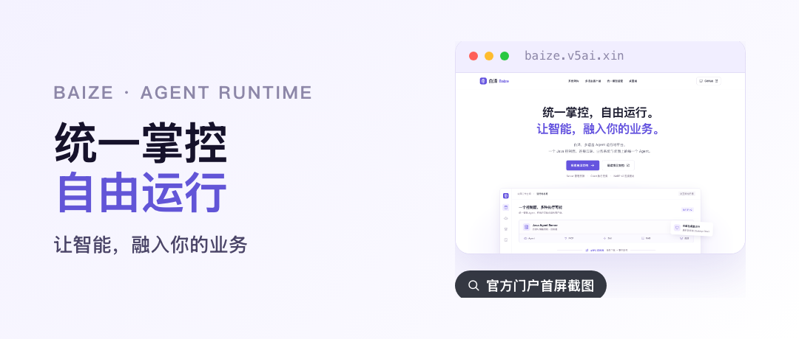
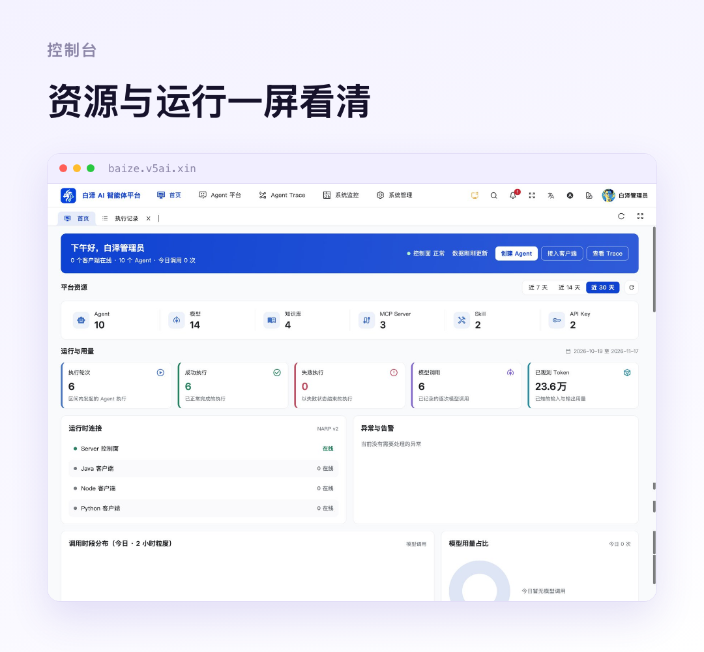
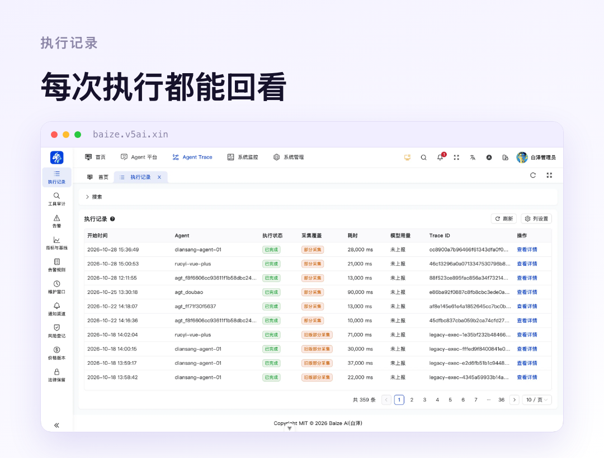
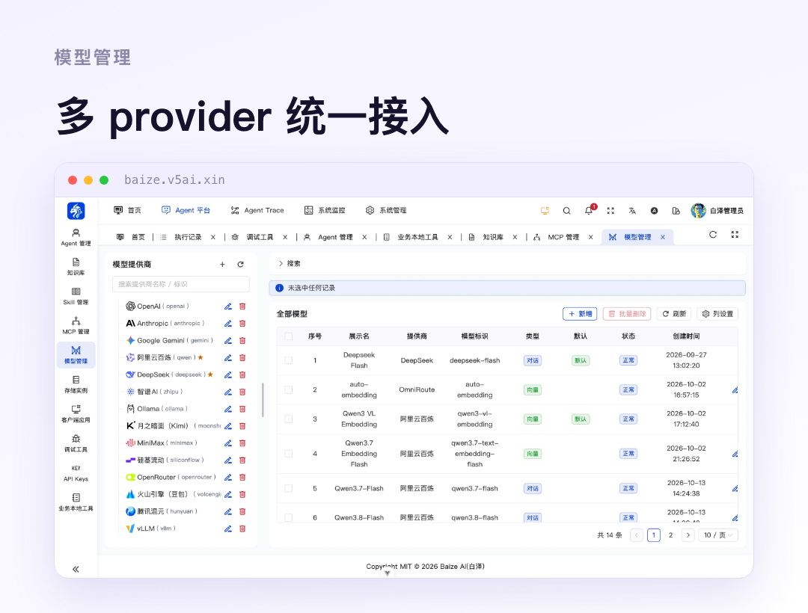
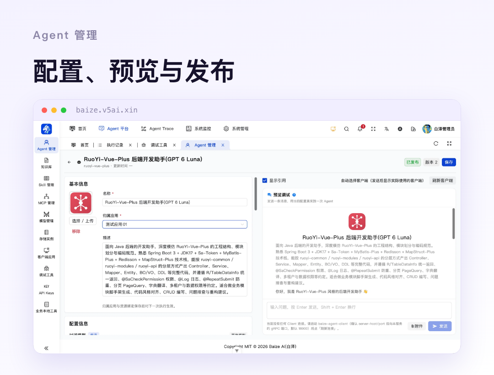
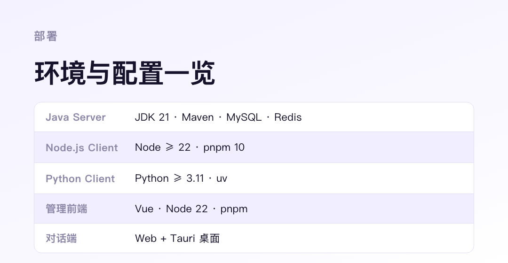

# 白泽：一个 Java 控制面，把 Agent 跑到你的业务与桌面上

> 摘要：白泽：多语言 Agent 运行时平台，Java Server 统一管理，经 NARP v2 连接多端执行。

**本文目录**

- 一、先说结论：白泽解决什么问题
- 二、Server 与 Client：两种职责
- 三、三次关键连接：一次对话怎么跑
- 四、能力矩阵：谁配置、谁执行
- 五、三端客户端与桌面
- 六、边界、部署与注意事项

把 Agent 从「演示」带到「真业务」，最难的不是模型，而是执行位置。

模型在云上，工具在自己的服务进程里，知识库在某个存储，桌面还要本地跑——东西越散，接起来越累。

白泽（Baize）是一套 Server–Client 模式的多语言 Agent 运行时平台：一个 Java 控制面统一管理 Agent、模型、MCP、Skill 与 RAG，把执行交给 Java、Python、Node.js 客户端，甚至桌面设备。

这篇基于官方 docs 与仓库源码梳理它怎么组织执行，以及哪里要先看清边界。

## 一、先说结论：白泽解决什么问题

白泽解决的是「Agent 要跑进各种业务现场」这件事。它的核心思路，是把「管理面」和「执行面」分开。

管理面由一个 Java Server 承担：它保存资源、校验准入、选择执行节点、编排执行并把会话持久化。你在这里配模型、配知识库、配 MCP、配 Skill，再把 Agent 发布出来。

执行面由 Agent Client 承担：它主动连接 Server，在业务进程里调用模型、运行 Agent Loop、执行本地业务工具和 MCP。Client 可以部署在业务服务、独立进程，或 Tauri 桌面应用中。

一句话：Server 告诉你「让谁跑、用什么跑」，Client 负责「怎么跑」。

## 二、Server 与 Client：两种职责

Server 负责「谁可以执行、使用哪些配置、交给哪个客户端」；Client 负责「怎样调用模型、怎样执行工具、怎样上报过程」。协议不绑定某一种 Agent 框架。

Java Client 使用 AgentScope，Python Client 使用 LangGraph（模型集成用 LangChain），Node.js Client 使用 Pi Agent。三种语言复用共同的 NARP v2 协议与适配契约，同时保留各自的实现方式。

客户端主动建立 gRPC 双向流连接 Server，所以不需要 Server 反向了解客户端的地址。这个设计让 Client 能安全地藏在业务网络或桌面设备后面。

现有实现覆盖 Java、Python、Node.js。Rust 与 Golang 的独立 SDK 属于规划，暂不是当前可接入的方式。

## 三、一次对话怎么跑

用户从对话或调试入口选择 Agent，提交输入。Server 解析用户身份、Agent 配置和本次用到的资源。

路由器在符合条件（在线、未排空、能力满足）的客户端节点中选择执行位置，然后沿 NARP v2 连接下发执行配置及运行需要的凭据。

Client 运行 Agent Loop，调用模型与工具，把文本、思考、工具和完成事件回传；Server 通过 SSE 向前端转发进度，并处理会话历史与执行状态。

结束后可在 Agent Trace 里按这次执行回看准入、握手、选择、派发、工具、结束各环节。

## 四、能力矩阵：谁配置、谁执行

白泽用「管理和配置」「运行时执行」两列来组织能力，避免一个常见误区：Server 能访问模型，不代表 Client 也能访问。

对话模型属性在 Server 管理，但由 Client 发起调用；RAG 由 Server 检索，Client 接收结果或预注入上下文；MCP 由 Server 发现与授权，Client 建立连接并调用。

更特别的是「业务工具」：你把它声明在业务进程里，连接和重连时上报静态定义，通过校验后由该节点执行。方法留在原地，Agent 只是在调用它。

还有记忆与联网搜索这样的 Server 工具——相关能力由 Server 管理，通过工具调用返回给 Agent。

## 五、三端客户端与桌面

三端各有适合的场景：Java 接已有 Spring / Java 业务应用；Python 面向数据处理或 Agent 应用；Node.js 适合 TypeScript 服务与桌面 sidecar。

桌面执行走 Tauri 对话客户端：Rust Host 启动固定 sidecar，sidecar 通过 NARP 连接 Server，Agent Loop 使用 Pi Agent。启用后当前桌面的对话就在本机执行。

桌面需要独立的客户端应用身份、短时来源票据和桌面执行授权；启用后若本机断线，新的本机执行会失败，不会自动改派到其他端。

这也说明白泽对「执行位置」是显式管理的：你要明确告诉它把任务发给谁，而不是期望它全网自动找端。

## 六、边界、部署与注意事项

先说边界：白泽管理的是「执行的组织方式」，不是「零配置一键跑」。要让它真正干活，你仍要理会配置模型、接入客户端、部署 Server 与数据库、配好 Redis 与外部密钥。

NARP v2 当前未启用 TLS。官方明确要求把 gRPC 运行时端口限制在受信任网络内，不要把明文传输的端口直接暴露到不可信网络。

部署上，Java Server 需要 JDK 21 与 Maven；默认 HTTP 端口 8880、gRPC 18900（可覆盖）。首次启动前要在独立环境配自己的数据库与 Redis，不要把示例命令指向共享库。

适合：有跨语言团队、想让 Agent 跑进多方业务进程、或需要桌面本机执行的团队。不适合：只想零配置体验、或对生产安全要求极高而未做额外防护的场景。

> 白泽的价值在「组织执行」：在 Server 管能力，让 Client 在它该在的地方跑。

真正想让 Agent 落地业务，管理能力和执行位置是对半分的事。白泽把这两半都显式管起来，也把边界的判断权交回给你。

---

**官网：**https://baize.v5ai.xin/
**文档（快速上手）：**https://baize-docs.v5ai.xin/zh/start
**后台仓库：**https://onedev.v5ai.xin/baize

> 关注「Agent 运行时」，每周拆一个真实可部署的 Agent 平台
