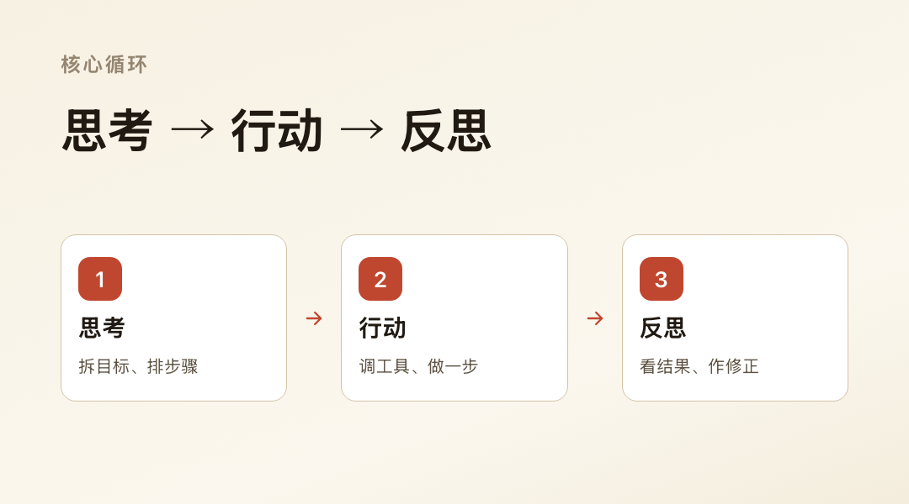
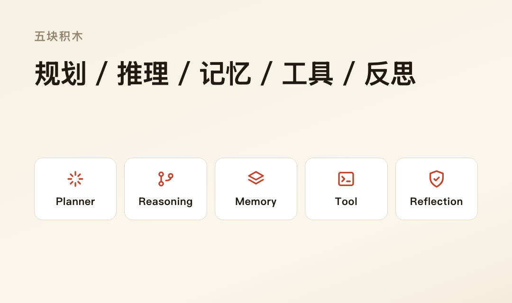
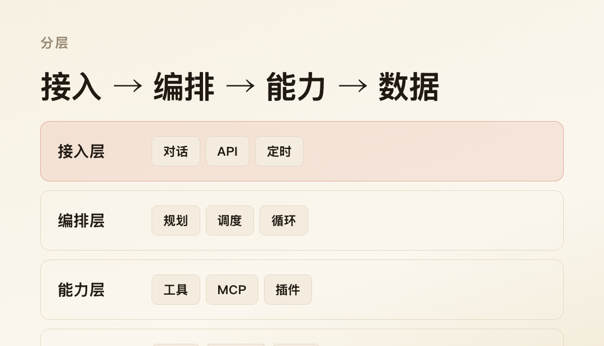

# 原理图解｜AI Agent 到底是怎么跑起来的

> 摘要：用一张图讲清 Agent 的核心循环与五块积木：规划、推理、记忆、工具、反思。

**本文目录**

- 一、先说结论：Agent 就是一个循环
- 二、五块积木，各管一段
- 三、它们是怎么连起来的
- 四、什么时候该自己搭

很多人对 Agent 的理解，还停在「会调用工具的聊天框」。

但真正让一个 Agent 稳定干活的，不是模型多强，而是它能不能把一个模糊的目标，拆成一步步能执行的动作，并且在出错时自己纠正。

这篇文章不讲玄学，只把 Agent 拆成一张图：一个核心循环，五块积木。看懂这张图，你再看任何 Agent 产品，都能对上号。

## 一、先说结论：Agent 就是一个循环

一句话概括：Agent 是「思考—行动—反思」的循环，直到目标完成。

它先理解你要什么，把目标拆成步骤；然后调用工具执行一步，看看结果；再根据结果决定下一步，或者发现走错了就修正。

这个循环听起来简单，但每一步都对应一块能力。少了哪一块，Agent 就会跑偏：不会拆就瞎忙，不会记就重复问，不会反思就一错到底。

## 二、五块积木，各管一段

第一块是 Planner（规划）。它负责把「帮我做一份竞品分析」这种大目标，拆成搜集资料、整理信息、分析对比、生成结论这样的小步骤。

第二块是 Reasoning（推理）。它决定当下这一步该做什么、用哪个工具、参数怎么填。

第三块是 Memory（记忆）。它记住你的偏好、当前任务的上下文、以及已经完成到哪一步，避免重复劳动。

第四块是 Tool（工具）。浏览器、代码执行、数据库查询、发消息——真正干活的都是它。

第五块是 Reflection（反思）。它检查结果对不对，发现不对就回到前面重来。这一块最容易被忽略，却决定了 Agent 靠不靠谱。

## 三、它们是怎么连起来的

从工程视角看，一个 Agent 通常分四层：接入层、编排层、能力层、数据层。

接入层负责收需求：对话、API、定时任务都从这里进来。编排层是大脑，负责规划、调度和循环。能力层放工具和 MCP，真正动手。数据层存记忆、知识库和日志。

分层的好处是「出错能定位」：是没规划好、工具调错了，还是记忆没接上，一层一层查就行，而不是对着一个大黑盒猜。

对使用者来说，这意味着你不必自己从零搭。多数场景用现成框架，把这几层接起来即可。

## 四、什么时候该自己搭

先说清楚：大多数需求不需要自己搭 Agent。现成产品 + 几个工具，就能覆盖日常的检索、写作、数据处理。

真正需要自己搭的，通常是两类：一是流程高度定制、现成产品改不动；二是数据敏感、必须私有化部署。

自己搭的代价是维护：模型会更新、工具会变、提示词要迭代，这些都得有人管。别为了「看起来像在做 AI」而上，先问一句：现成方案到底卡在哪。

把 Agent 当工具，而不是当目标，判断就清楚了。

看懂这张图，你就有了判断力：下次再看到某个 Agent 产品，能立刻问出「它的规划、记忆、反思分别在哪一层」。

---

**延伸阅读：**https://example.com/agent-notes

> 关注「原理图解」，把复杂的东西画成一张图