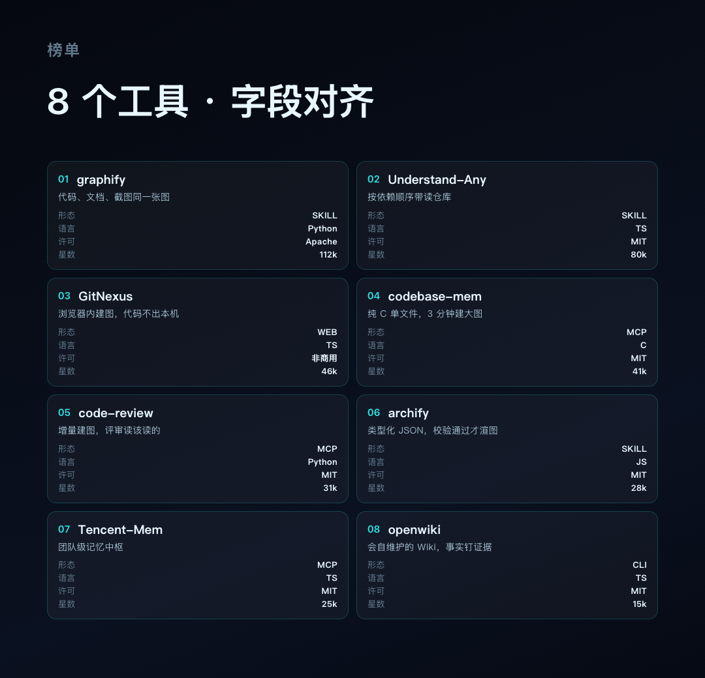

# 写代码也要建知识图谱：8 个工具，一张表挑

> 摘要：一张卡片墙盘 8 个知识图谱工具：形态、语言、许可、星数一目了然，附三个选型问题。

**本文目录**

- 一、为什么建议建知识图谱
- 二、8 个工具一张榜
- 三、先答三个问题再选
- 四、怎么用这份榜单

写代码碰上陌生仓库，最耗时间的不是查文档，而是「找不到对象」。

函数在哪定义、这个状态被谁改、那个服务依赖哪些表——靠搜靠翻，效率很低。

知识图谱把这层关系整理成一张能查的结构，评审时还只读该读的上下文，实践里能省下可观的 token。

下面是 8 个方向的知识图谱工具榜单，形态、语言、许可、星数对齐排列。先看全表，再谈选型。

## 一、为什么建议建知识图谱

知识图谱不是玄学，本质是把「跨文件的调用、依赖、引用」建成一张图，让查询取代猜测。

对写代码来说，它是码前视图：想改一个函数，先看清它被谁引用，改动前就摸清爆炸半径。

对做内容也一样——把零散的文档、截图、笔记整理成关系网，之后检索一次到位。

榜单里很多工具强调「增量 + 只读」：评审时只把该读的上下文放进窗口，省 token 也省注意力。

## 二、8 个工具一张榜

榜单把八个工具按「形态 / 语言 / 许可 / 星数」四个字段对齐。形态决定了它怎么进你的工作流——是一个可读写仓库的 Skill，还是一个只读的 MCP 服务。

粗略分两类：一类偏「读图给人看」，比如架构图的 archify、浏览器里零安装的 GitNexus；另一类偏「读图给 Agent 用」，比如增量评审的 code-review、超大仓库的 codebase-mem。

许可也值得注意：多数是 MIT/Apache 开源，个别非商用——接单前务必看一眼。

星数只是参考座标，不代表适不适合你；榜单最后专门给了三个选型问题。

## 三、先答三个问题再选

第一个问题：代码能出库吗？能出库、只是临时看，用浏览器里的 GitNexus 就很方便；对代码有保密要求，就选本地建图的 MCP。

第二个问题：团队要共享索引吗？只有自己用，本地工具够了；要让更多人查，就挑带团队记忆中枢、能跟大家共建索引的。

第三个问题：读图的是人还是 Agent？人看架构图、想可视化，archify 这类「可验证渲染」更合适；Agent 要按图拿上下文，走 MCP 工具更顺。

答完这三个，通常只剩 1–2 个候选。别看完榜单一把全装——工具不是收藏品。

## 四、怎么用这份榜单

如果你只是路人，收藏这张榜，理论够了；真到选型那天再逐条核实。

如果你要对号入座，从三问里定下 1–2 个候选，去各自仓库确认星数和许可证，再看是否有近期维护。

需要强调：本榜单为演示数据，星数、形态、许可均为虚构示例，不代表真实状态。

榜单的价值不在「谁第一」，而在把维度摊开——你做选择时知道自己到底在比什么。

知识图谱的价值，不在把一切都装进一张图，而在让你该看清的地方一次看清。

---

**专题主页：**https://example.com/ai-geo

> 关注「Agent 经纬」，每周一张能上手的工具榜