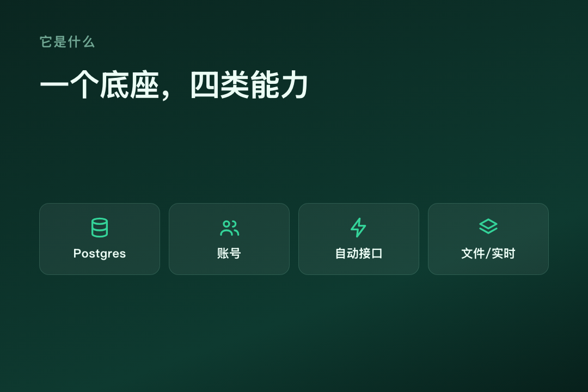
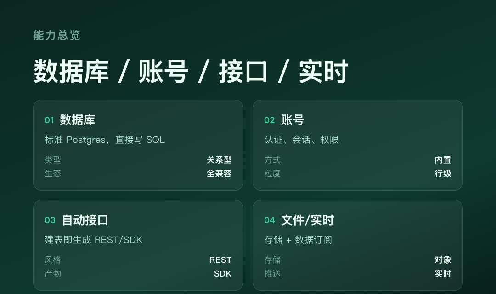
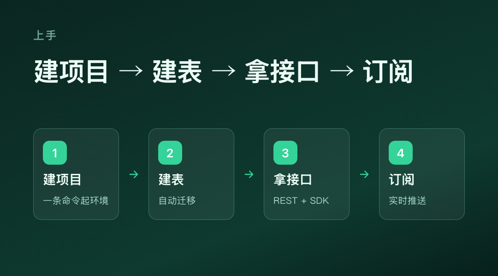

# 开源｜一款一体化后端，Postgres + 登录 + API + 存储全包了

> 摘要：以 Postgres 为核心，把数据库、登录、自动 API、文件存储收进一个开源项目；附上手四步与真实边界。

**本文目录**

- 一、先说结论：它想解决什么
- 二、核心能力：四件事一个项目
- 三、上手四步
- 四、边界与适用场景

做后端最烦的，往往不是写业务，而是「把地基拼起来」。

数据库一套、登录一套、接口一套、文件存储再一套；每套都有自己的配置、部署和升级方式。东西还没开始写，光是把它们凑齐、跑通，一周就过去了。

Stackbase 想解决的就是这件事：以一个 Postgres 为核心，把数据库、账号、自动 API、文件与实时能力收进一个项目。你不用在几个控制台之间来回切，建表就能拿到接口。

这篇会讲清它解决什么问题、怎么做到、以及哪里帮不上你。

## 一、先说结论：它想解决什么

一句话概括：它不是又一个框架，而是一套「拼好了的后端底座」。数据库是 Postgres，账号、接口、存储都围绕它长出来。

传统的做法是每个能力选一个最合适的工具，再自己接缝。问题是接缝处最容易出事故：token 怎么传、文件权限怎么控、表结构变了接口要不要重发。

Stackbase 把这些接缝提前焊死。你把表建好，接口按约定自动生成；你开一个用户体系，权限直接挂在数据行上。对独立开发者和中小团队来说，省下的正是这部分「看不见但很费时」的工作。

## 二、核心能力：四件事一个项目

第一是数据库。它就是标准 Postgres，意味着你不用学一套新查询语言，社区里的工具、备份、监控都能直接用。

第二是账号与登录。注册、登录、第三方登录、行级权限这些常见需求都内置了，不用再单独部署一个认证服务。

第三是自动 API。建完表，REST 接口和客户端 SDK 跟着生成；前端不用等后端排期，自己就能把页面接上。

第四是文件与实时。上传的文件有地方存，表里的数据一变，订阅端能立刻收到推送，做协作和通知类功能很省心。

## 三、上手四步

第一步，装好本地环境。官方给了一条命令，跑完数据库、接口、控制台都起来了，不用自己配 Docker 编排。

第二步，建表。在控制台里定义字段和关系，它会自动生成迁移；也可以直接写 SQL，随你喜欢。

第三步，拿接口。表建好后，REST 接口和 SDK 立刻可用，前端可以并行开发，不必等后端排期。

第四步，订阅变化。需要实时的地方开一个订阅，数据更新时客户端就能收到，不用自己搭长连接。

> 省下的不是写代码的时间，而是「把服务拼起来、接缝调通」的时间。

## 四、边界与适用场景

先说边界。它帮你把常用后端能力拼好，但复杂业务逻辑、定制权限、性能优化，仍然要你自己写；它不是「零代码建站」。

本地开发环境也不等于生产部署。自托管时，服务器、备份、安全更新、访问控制都要你维护；图省事就用官方托管，但要接受它的定价与限制。

适合：独立开发者做 MVP、小团队做内部工具、想快速验证想法的人。不适合：需要极致定制、强合规、超大规模并发的场景。

把它当「进门的地基」而不是「终点的答案」，预期就对了。

一句话：先有一个能跑的地基，再去想业务怎么长。对多数小项目来说，这比一开始就追求完美架构更划算。

---

**项目地址：**https://example.com/stackbase
**在线体验：**https://stackbase.dev

> 关注「开源精选」，回复「后端」领取上手清单