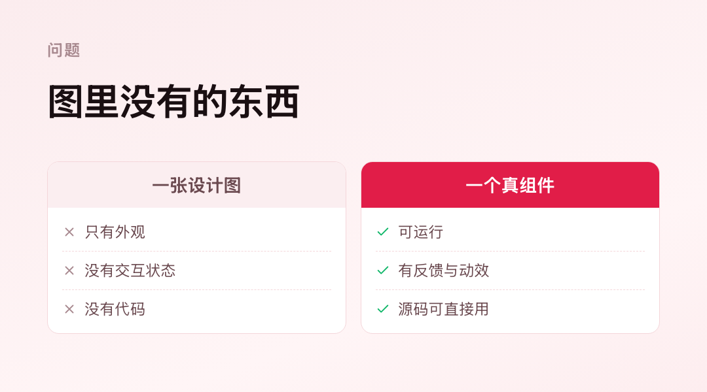
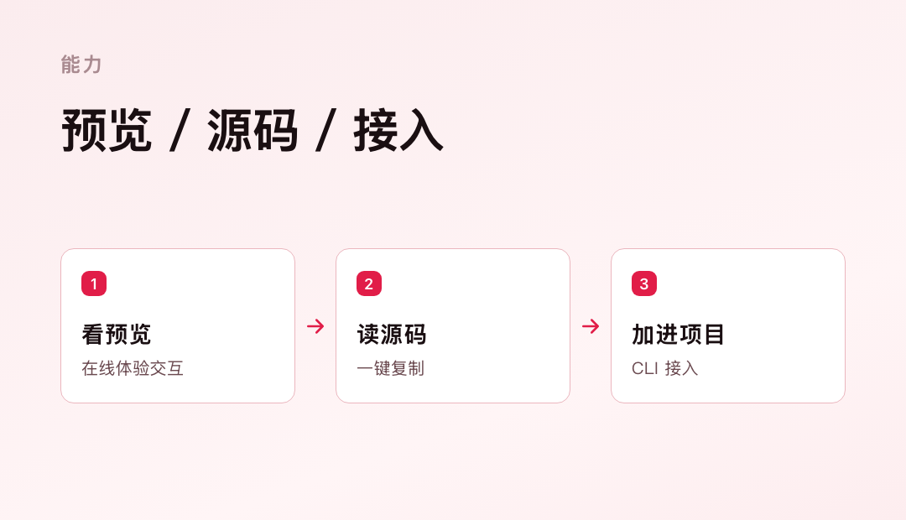
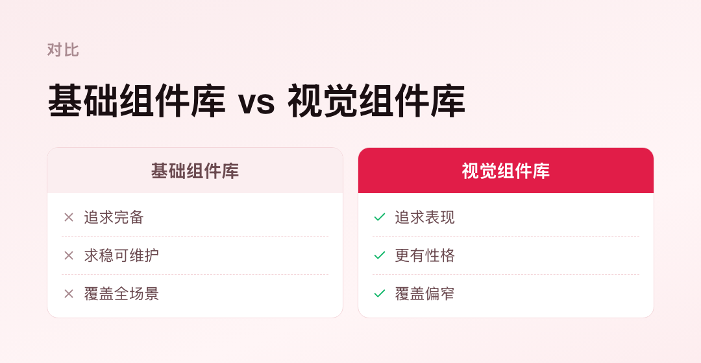

# 新开源｜把设计灵感，做成能跑的 React 组件

> 摘要：把静态设计灵感重新实现成带交互的 React 组件，在线预览、源码可抄，附适用与边界。

**本文目录**

- 一、收藏夹里的图，为什么用不上
- 二、它做了一件什么事
- 三、它和普通组件库的区别
- 四、适用与边界

做前端的人，大概都有一个塞满截图的收藏夹。

看到一个好看的卡片、一个顺滑的输入框，先存下来；真到项目里要用，又得对着图从头写一遍。

问题不在于没有灵感，而在于「灵感停在图片里」——它没有交互、没有状态、没有代码。

Mosaic UI 想做的，就是把这些静态设计重新实现成能跑的 React 组件。这篇讲清它做了什么、和普通组件库差在哪、以及什么时候别用它。

## 一、收藏夹里的图，为什么用不上

一张设计图只告诉你「它长什么样」，却没告诉你「它应该怎么动」。

按钮按下有没有反馈、输入框聚焦时边框怎么变、列表加载时骨架屏怎么过渡——这些细节决定了组件好不好用，而它们都不在图里。

所以把截图变成组件，中间还需要大量设计判断：交互状态、动画节奏、操作反馈、以及怎么落地到具体框架。这正是普通「灵感站」帮不上的地方。

## 二、它做了一件什么事

Mosaic UI 从真实的设计作品出发，把其中的界面重新实现成可运行的 React 组件。

你在它网站上看到的每个组件，都能在线预览、看源码，并通过一条命令加进自己的项目。

它不追求覆盖所有场景，而是偏向「视觉表现与交互实验」：一些有创意的卡片、输入控件、模拟真实物体的交互，以及各种有趣的动画。

换句话说，它更像一座「灵感 → 代码」的桥，而不是一套求全求稳的基础组件库。

## 三、它和普通组件库的区别

普通组件库以 Button、Input、Dialog 这类基础件为核心，追求稳定、可维护、覆盖全。

Mosaic 走的是另一条路：从视觉灵感库反向筛选值得实现的设计，再把它做成组件。所以它天然更「有性格」，但覆盖面也更窄。

对做营销页、作品集、实验性产品的团队，这种「有性格」正是价值；对做大型后台、追求一致性的团队，它更适合当补充，而不是主力。

## 四、适用与边界

先说边界。它偏新，组件数量不算多，复杂业务场景覆盖不了；把它当唯一组件库，大概率会缺件。

它更适合当「灵感与实现参考」：需要某个有性格的交互时，来这儿找一件，改一改放进项目。

适合：营销落地页、作品集、实验性产品、想给页面加一点记忆点的团队。不适合：追求完备与长期稳定的中后台系统。

一句话：它是灵感库的下一站，不是组件库的替代品。

把「收藏了一张图」变成「拿走一段能跑的代码」，这才是灵感真正落地的方式。

---

**项目地址：**https://example.com/mosaic-ui
**在线预览：**https://mosaic-ui.dev

> 关注「开源精选」，回复「组件」领取清单