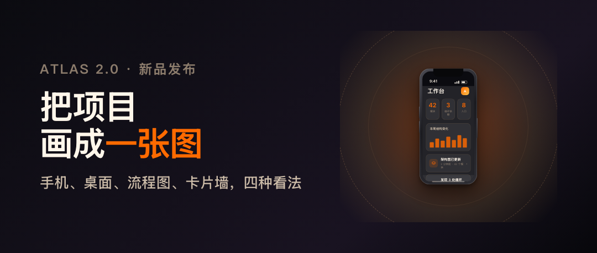
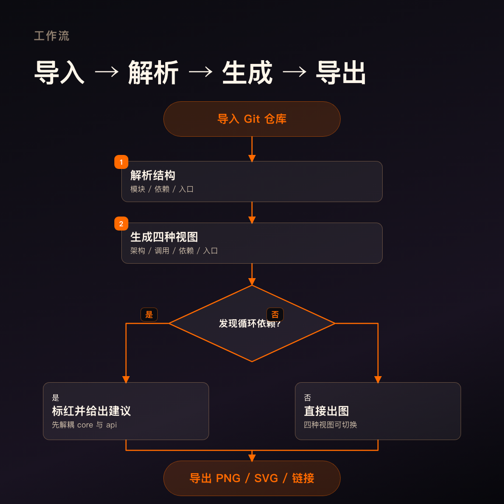
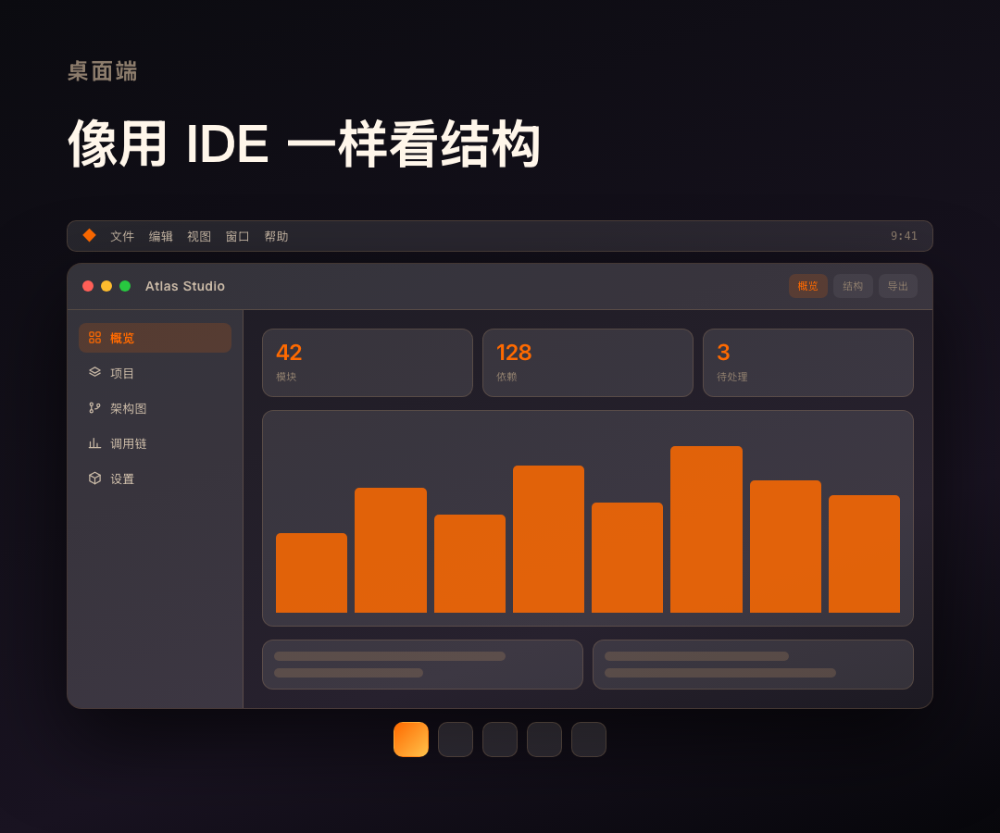

# Atlas 2.0：把项目画成一张能转发的图

> 摘要：Atlas 2.0 把仓库变成四种视图：手机里聊一句、桌面上看一眼，流程图讲清判断，卡片墙扫完能力。

**本文目录**

- 一、为什么你需要的是一张图
- 二、它怎么把仓库变成图
- 三、手机里也能把图聊出来
- 四、桌面上的一张地图
- 五、四种视图，四种读法
- 六、边界与适用场景

接手一个新仓库，最花时间的往往不是改代码，而是先弄明白它到底怎么跑起来的。

目录几十个、入口好几个、模块之间谁调谁，光靠翻文件和搜索，很容易越看越乱。

Atlas 2.0 想解决的就是这件事：把仓库丢进去，自动画出一张能转发的图，让「问人」变成「看图」。

这篇文章会讲清楚它怎么做到、四种视图分别用在哪，以及它帮不上忙的地方。

## 一、为什么你需要的是一张图

先说一个常见场景：你接手一个三年前的项目，README 只有三行，提交记录几万条，目录树拉下来屏幕都装不下。

你想改一个看似简单的功能，改完才发现牵动了七八个模块；你想删一个「看起来没用」的文件，结果线上挂了。这类事故大多不是能力问题，而是「没有地图」在裸奔。

传统的解决办法是问人、翻文档、画草图。但人会走、文档会过期、草图只存在某个人的白板照片里。一张能持续更新、全团队共享的架构地图，才是可以沉淀的资产。

## 二、它怎么把仓库变成图

流程其实很简单：导入仓库 → 解析结构 → 生成四种视图 → 导出分享。每一步都有明确的产物，失败了也能知道卡在哪一步。

解析层会做语言识别、AST 解析和依赖抽取，所以它给出的不是一张示意图，而是能对上代码的图。点开任意一个模块，你能看到它对应的目录、关键文件和被谁引用。

举个具体的例子：你想知道「支付回调」是怎么走到数据库的。以前要在三个仓库里搜关键词，现在点开「支付」节点，沿着调用链一路往下，中间经过哪些服务、落到哪张表，一目了然。

导出支持 PNG、SVG 和在线链接。写评审文档用 PNG，做架构汇报用 SVG，发给同事看用链接，各取所需。

## 三、手机里也能把图聊出来

很多架构图工具默认你坐在电脑前，但真实情况是：你在群里看到同事丢来一个仓库地址，想立刻知道它大概长什么样。

Atlas 2.0 把入口做进了对话：把地址发给助手，解析完成后直接回一张图，下面带一个「打开」按钮。你不用切 App、不用登录网页，也不用先读一遍 README。

这张图还能直接转发到群里。对做技术评审的人来说，这比甩一个仓库链接有效得多——对方点开就能看到模块和依赖，而不是先花十分钟找入口。

当然，手机屏幕小，适合「先看一眼」；真要逐层展开、对比调用链，还是回到桌面更舒服。

## 四、桌面上的一张地图

回到桌面，Atlas Studio 更像一个专门看结构的 IDE：左边是模块树，中间是画布，顶部是视图标签页，右侧可以展开某个节点的详情。

它把「看结构」和「改代码」分开了。你不需要在编辑器里装一堆插件，也不需要在浏览器和终端之间来回切；打开一个窗口，结构就在那里。

对团队来说，这意味着新人第一周不必逢人就问「这个功能从哪进」。把仓库丢进去，先看一遍图，再带着问题去问，效率完全不同。

如果你习惯深色界面，它也有对应的深色主题；截图里的数字都是演示数据，真实项目会按你的仓库生成。

## 五、四种视图，四种读法

架构视图看分层：哪些是接入层、哪些是服务层、哪些落到数据层。它回答的是「这个系统由哪几块组成」。

调用视图看链路：从一个入口出发，经过哪些模块、最终落到哪里。它回答的是「这个功能是怎么跑起来的」。

依赖视图看耦合：谁引用了谁、有没有循环。它回答的是「改这里会不会牵动别处」。

入口视图看动线：用户或定时任务从哪里进来、经过哪些处理。它回答的是「这个系统是怎么被使用的」。

四种视图不是四个页面，而是同一份结构的四种投影。切换视图不会重新解析，所以你可以放心地在它们之间来回跳。

## 六、边界与适用场景

要说明的是，Atlas 目前对动态语言的支持好于重度元编程的代码，遇到高度动态的调用可能识别不全，需要人工补几笔。

它也不做运行时分析，图是静态结构，真正的性能问题还得靠 profiler。把它当「进门的地图」，而不是「终点的答案」，预期就对了。

如果你要的是「一键重构」，它帮不上；如果你要的是「三分钟看懂结构、把知识沉淀成图」，它正合适。

适合：新人上手、跨团队交接、评审前快速评估、技术债盘点。不适合：线上排障、性能调优、需要精确到行的调用统计。

| 场景 | 是否适合 | 建议 |
| --- | --- | --- |
| 新人接手 | 适合 | 先看架构与入口 |
| 跨团队交接 | 适合 | 导出 PNG 放进文档 |
| 线上排障 | 不适合 | 用日志与 profiler |
| 性能调优 | 不适合 | 用压测与火焰图 |

一句话：把「谁记得」变成「谁都能查」，这就是架构地图最大的价值。Atlas 2.0 值得放进你的工具箱。

---

**项目地址：**https://example.com/atlas
**在线体验：**https://atlas.dev/studio

> 关注「新品发布」，回复「架构」领取示例模板
