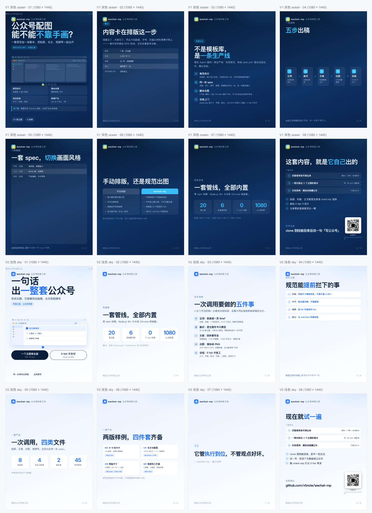

# wechat-mp-self · 用 wechat-mp 给 wechat-mp 做一期公众号

> 自举案例：**这个项目给自己写公众号内容**。主题、卖点、数字全部来自本仓库源码、README 与 SKILL.md，没有外部来源，也没有 Star / 下载量之类的不可核数据（见 [facts.md](facts.md)）。
> 产出同样由 `build.mjs` 现场渲染：贴图、封面、正文配图、视频号封面全部是这套管线的产物，`check.mjs` 与 `validate-pair.mjs` 双 0 fail。



## 两版：一深一浅（SKILL.md 配色铁律）

| 版本 | 主题 / 明暗 | 视角 | 贴图 | 文章 | 视频号 |
|---|---|---|---|---|---|
| [V1 ocean](out/v1-ocean/) | `ocean` · **深色系** | 「做法」：它怎么替你省掉最后一公里 | 8 张 · 3:4 | 1518 字 · 4 图 · 6 节 | 口播干货 · 31s 成片（TTS 旁白） |
| [V2 sky](out/v2-sky/) | `sky` · **浅色系** | 「清单」：先看数，再照单做 | 8 张 · 3:4 | 1405 字 · 4 图 · 5 节 | 图文轮播 · 28s 成片（静音） |

```
$ node scripts/validate-pair.mjs examples/cases/wechat-mp-self/*.spec.json
主题明暗：ocean=dark  sky=light
  ✓ 两版一浅一深：ocean（dark）/ sky（light）
  ✓ 两版结构不同：卡片序列 / 主视觉类型 / 文章骨架
```

标题备选（推荐项已加粗标在 `文案.md` 里）：

- V1：**一条命令，把项目做成公众号：贴图、长文、视频号一次出齐**
- V2：**公众号配图交给脚本：wechat-mp 的五步出稿法**

**两版不仅一浅一深，也不是换皮**：卡片序列、主视觉组件、正文骨架、配图类型、视频形式都不同
（V1：flow / steps / compare / stat / 口播，6 节带「先说结论」式导语；V2：数据开场 + 清单 + 规格 + 边界，5 节清单式，图文轮播）。

## V1 ocean（深色）· 卡片序列

| 卡片 | 覆盖卖点 | 视觉组件 |
|---|---|---|
| [cover](out/v1-ocean/cards/card-01.png) | 公众号配图能不能不靠手画？（**dev-dark** 版面） | 桌面窗口 + 2×2 能力格 + 边界提醒 |
| [point](out/v1-ocean/cards/card-02.png) | 内容卡在排版这一步 | kv |
| [list](out/v1-ocean/cards/card-03.png) | 不是模板库，是一条生产线 | blist |
| [diagram](out/v1-ocean/cards/card-04.png) | 一次调用五步出稿 | steps |
| [diagram](out/v1-ocean/cards/card-05.png) | 六类画面，一套 spec 切换 | kv |
| [compare](out/v1-ocean/cards/card-06.png) | 手动排版 vs 规范出图 | compare |
| [stat](out/v1-ocean/cards/card-07.png) | 20 套主题 / 6 类画面 / 0 依赖 / 1080px | stats |
| [ending](out/v1-ocean/cards/card-08.png) | 这套内容就是它自己出的 + 下期预告 + 真二维码 | qr |

## V2 sky（浅色）· 卡片序列

| 卡片 | 覆盖卖点 | 视觉组件 |
|---|---|---|
| [cover](out/v2-sky/cards/card-01.png) | 一句话出一整套公众号（**tool-brief** 版面） | 超大头版 + 桌面窗口 + 底部双 pill |
| [stat](out/v2-sky/cards/card-02.png) | 先看数 | stats |
| [list](out/v2-sky/cards/card-03.png) | 动手清单：五件事 | blist |
| [diagram](out/v2-sky/cards/card-04.png) | 规范能提前拦下的事 | checklist |
| [stat](out/v2-sky/cards/card-05.png) | 本案例实际产出四类文件 | stats |
| [grid](out/v2-sky/cards/card-06.png) | 四件套齐备 | matrix 2 列 |
| [quote](out/v2-sky/cards/card-07.png) | 能力边界金句 | quote |
| [ending](out/v2-sky/cards/card-08.png) | 现在就试一遍 + 下期预告 + 真二维码 | qr |

## 事实与素材

- 事实表：[facts.md](facts.md) —— 每条数字都标注了仓库内的出处；**不写** Star、下载量、效果承诺。
- 品牌：没有独立 logo，用字母块「微」，栏目名写「公众号内容工坊」；二维码指向 `https://github.com/v5note/wechat-mp`，与文章 `links` 第一条一致。
- 截图：**没有产品界面可截**，因此不使用 `shot` 真实截图框；正文配图全部是本项目会产出的版式，由脚本渲染，来源即仓库规范。
- 打磨过程：[polish-log.md](polish-log.md)（两轮，逐条可查；含「两版配色改成明暗对照」这一轮）。

## 复现

```bash
node scripts/build.mjs --spec examples/cases/wechat-mp-self/v1-ocean.spec.json --out examples/cases/wechat-mp-self/out/v1-ocean
node scripts/build.mjs --spec examples/cases/wechat-mp-self/v2-sky.spec.json   --out examples/cases/wechat-mp-self/out/v2-sky
node scripts/check.mjs examples/cases/wechat-mp-self/out/v1-ocean examples/cases/wechat-mp-self/out/v2-sky
node scripts/validate-pair.mjs --all
```

每个版本目录含：`cards/`（8 张贴图）、`article/`（md + 内联 HTML + 两版封面 + 4 张配图）、`video/`（封面 + 口播稿/分镜或轮播脚本）、`文案.md`、`发布清单.md`、`index.md`。
