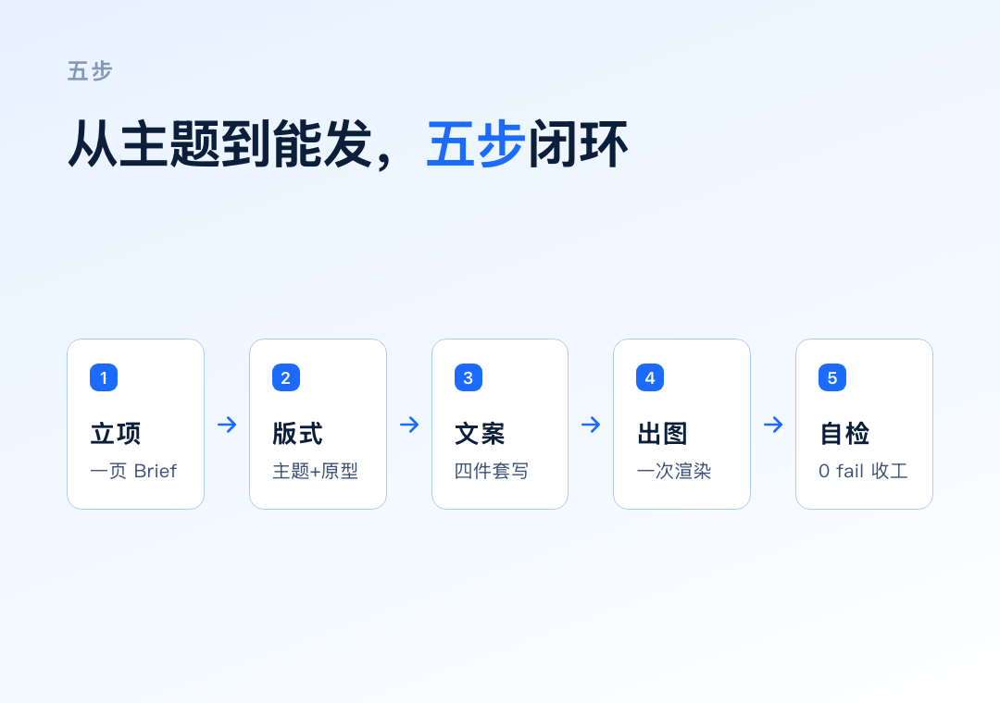
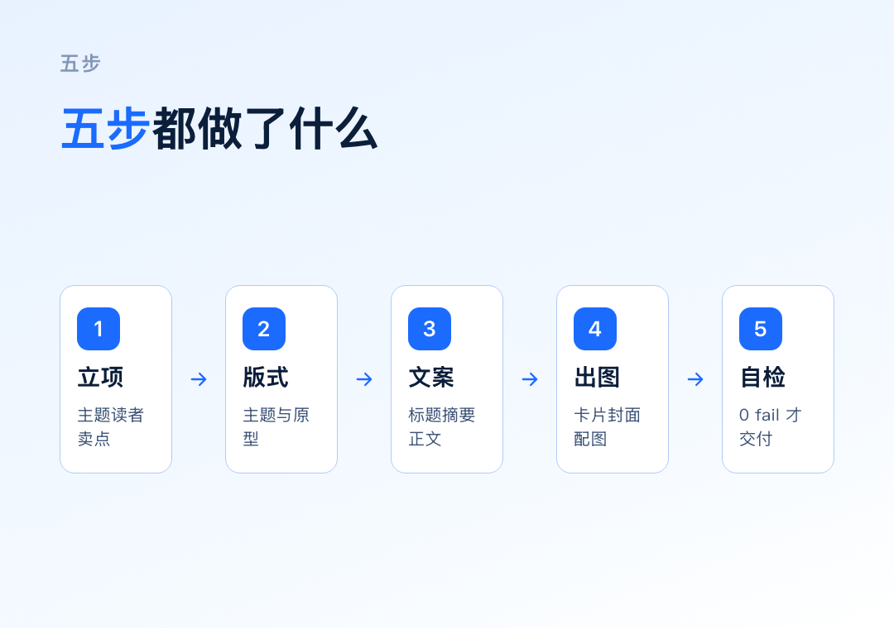
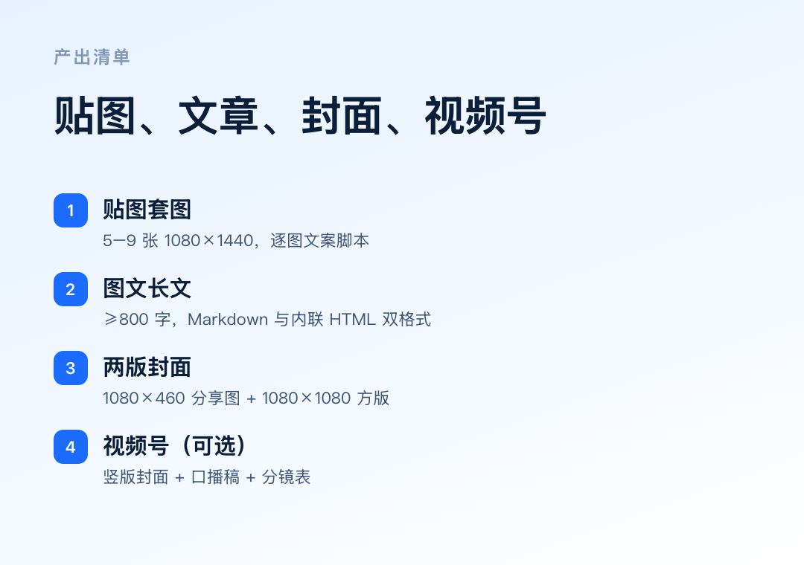
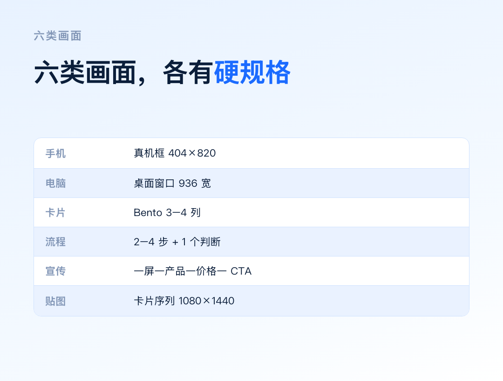

# 公众号配图交给脚本：wechat-mp 的五步出稿法

> 摘要：公众号内容自动化清单：从主题到能发只差五步，贴图、长文、封面、视频号同源产出，自检 0 fail 才交付。

**本文目录**

- 一、为什么值得把它当成一条流程
- 二、五步都做了什么
- 三、产出清单：贴图、文章、封面、视频号
- 四、画面风格与规格
- 五、边界：它管执行，不管观点

公众号内容难做，很多时候不是没东西写，而是写完之后还要把同一件事重复做很多遍：配图、改比例、数摘要字数、给图注编号。

wechat-mp 的做法是把它变成一条流程：一份 spec.json 承载内容，模板和脚本负责外观，最后统一自检。

这篇按清单的方式讲：五步分别做什么、最后能得到哪些文件、画面风格有哪些规格、以及哪些事它管不了。

## 一、为什么值得把它当成一条流程

公众号的产物是成套的：贴图、长文、封面、配图、可选的视频号，它们共用同一份事实和同一批卖点。如果是手工做，改一个数字就要在五六个文件里同步一遍。

流程化的价值就在这里：内容集中在一处，格式集中在规范里。改一个卖点，重新 build 一次，所有图与所有文同时更新。

代价是需要先接受一套规范：比例是定的、字号是取的、摘要不能超字数。一旦接受，剩下的都是点击率更高的那一部分工作——写什么、怎么说。

## 二、五步都做了什么

第一步立项：把主题收敛成一页 Brief，写清读者是谁、一句话定位是什么、3–6 个卖点分别能撑起哪张卡。缺信息就写假设，而不是停下来反复追问。

第二步版式：根据题材选主题和卡片原型。新品走发布骨架，横评走对比，原理走图解；两版之间至少有一处结构不同，只换配色不算两版。

第三步文案：每版至少三条标题、一条不超过 54 字的摘要、一篇不少于 800 字的正文，以及每张贴图卡的文字脚本。

第四步出图：build.mjs 把卡片、文章封面、正文配图、视频号封面一次渲染完，规格由模板和脚本决定，不靠手工调整。

第五步自检：check.mjs 逐项验收，有 fail 就回去改，警告逐条确认，0 fail 才交付。

## 三、产出清单：贴图、文章、封面、视频号

贴图是 5–9 张 1080×1440 的竖版卡片，每张只讲一个点，并配一段逐图文字脚本。

文章是一篇不少于 800 字的长文，建议 1500–3000 字，交替穿插 3–5 张宽 1080 的配图；同时给 Markdown 与内联样式的 HTML，后者可以直接粘进微信编辑器而不丢样式。

封面出两版：1080×460 用于分享卡片，1080×1080 的方版用于列表页。需要视频号时，再额外产出 1080×1920 的竖版封面、口播稿与分镜表。

## 四、画面风格与规格

六类画面风格各自对应一种内容场景：手机真机框适合移动端体验，桌面窗口适合后台产品，Bento 卡片墙适合清单与合集，判断流程图适合教程一图流，产品宣传海报适合新品，纯贴图卡片序列适合逐图讲要点。

规格是硬的：手机框 404×820，桌面窗口 936 宽，流程图 936 宽且 2–4 步加一个判断，Bento 3–4 列，宣传图一屏只放一个产品、一个价格、一个 CTA。

设备和宣传类配图还要标清楚来源：窗口里的界面要么是真实截图，要么明确写示意；宣传图上的价格必须有出处。示意要诚实，不能糊弄读者。

配套的是 20 套主题令牌，从深色科技到米色图解各有气质；换主题只改令牌，不改组件，因此同一套版式可以在深色与浅色之间整体切换。

## 五、边界：它管执行，不管观点

选题是否值得写、观点是否立得住、语气是否合适，这些仍然需要人判断，工具帮不上忙。

事实核查同样要自己做：真实产品、版本、价格、数据、人物，先查再写，查不到就写待确认，不要编。

还有一条容易被忽略：脚本能保证不越安全区、不溢出，但一个好版面和一张讲得清楚的卡，仍然需要逐张目检与迭代。自动化负责下限，上限还是人的事。

所以真正省下来的是排版与返工的时间，而不是思考的时间；这一点想清楚，就不会对它抱有不切实际的期待。

反过来说，如果一篇内容的价值主要来自观点与事实，那么花在排版上的时间越少越好——这也是把排版交给脚本最划算的地方。

如果你也想把公众号从“每次重做一遍”变成一条可复现的流程，仓库地址就在文末：clone 下来，新开一轮会话，说一句把这个主题做成公众号。

---

**GitHub 仓库：**https://github.com/v5note/wechat-mp
**工作流契约：**https://github.com/v5note/wechat-mp/blob/main/SKILL.md
**规范文档：**https://github.com/v5note/wechat-mp/tree/main/references

> 关注「公众号内容工坊」，每期一份能直接用的内容清单
