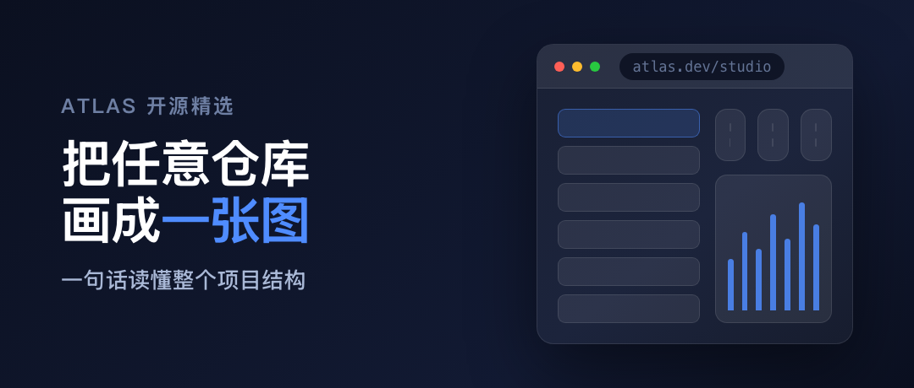
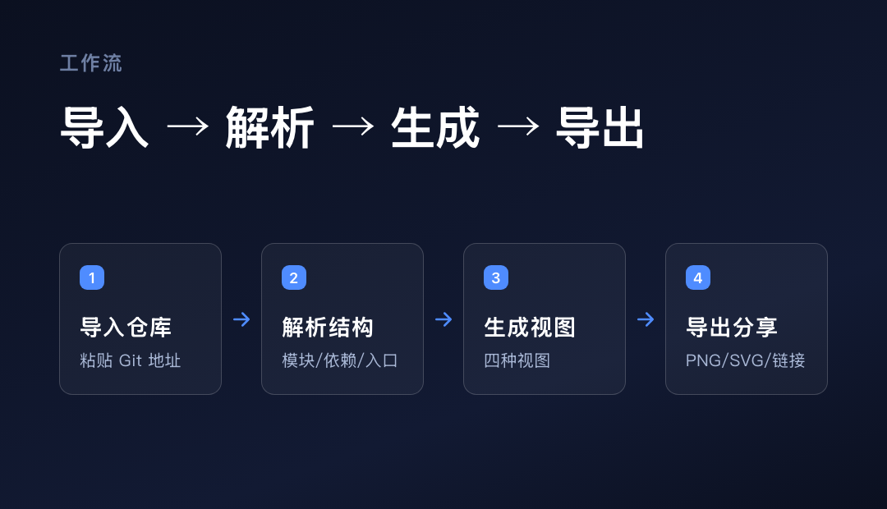
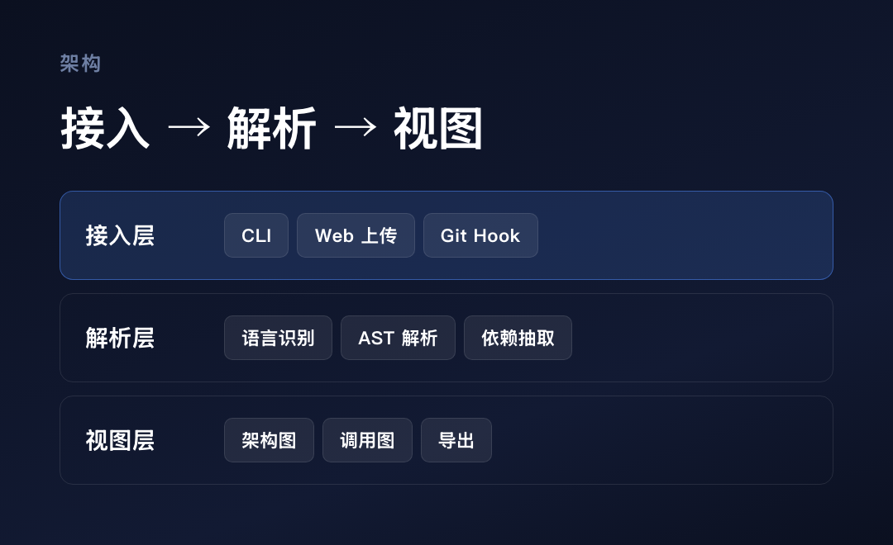
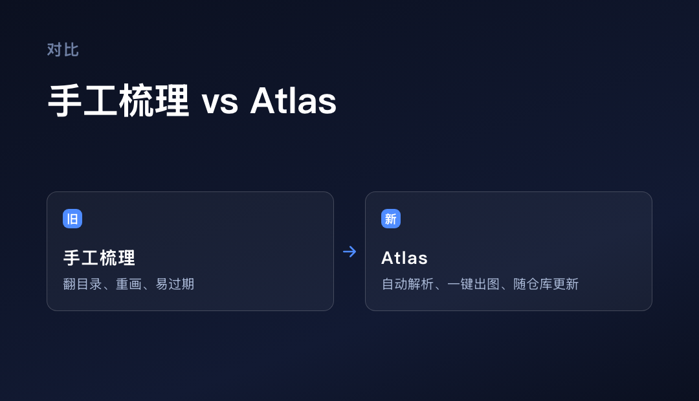

# 把任意代码仓库，画成一张能点开的架构图

> 摘要：把 Git 仓库丢进去，自动画出模块、依赖与调用关系；一张会自己更新的架构地图，让新人三分钟看懂项目。

**本文目录**

- 一、为什么你需要一张架构地图
- 二、先说结论：它是一张只读的地图
- 三、它怎么把仓库变成图
- 四、三层结构，各司其职
- 五、上手：三步跑出第一张图
- 六、值得试的三个理由
- 七、边界与适用场景

接手一个新仓库，最花时间的往往不是改代码，而是先弄明白它到底怎么跑起来的。

目录几十个、入口好几个、模块之间到底谁调谁，光靠翻文件和 grep，很容易越看越乱。

我见过不少团队，新人入职第一周有一半时间花在「问人」上：问这个接口在哪、问那个配置谁改的、问这个功能从哪进。

Atlas 想解决的就是这件事：把仓库丢进去，自动画出一张能点开的架构图，让「问人」变成「看图」。这篇文章会讲清楚它解决什么问题、怎么做到、以及哪里帮不上你。

## 一、为什么你需要一张架构地图

先说一个常见的场景：你接手一个三年前的项目，README 只有三行，提交记录几万条，目录树拉下来屏幕都装不下。

你想改一个看似简单的功能，改完才发现牵动了七八个模块；你想删一个「看起来没用」的文件，结果线上挂了。这类事故，大多不是能力问题，而是「没有地图」在裸奔。

传统的解决办法是问人、翻文档、画草图。但人会走、文档会过期、草图只存在某个人的白板照片里。一张能持续更新、全团队共享的架构地图，才是可以沉淀的资产。

## 二、先说结论：它是一张只读的地图

Atlas 的定位很清楚——只读的架构地图。它不替你改代码，也不做重构，只负责把「这个项目由哪些部分构成、它们怎么连起来」讲清楚。

导入一个 Git 地址，它会解析模块、依赖和入口，生成四种视图。整个过程不需要安装插件，浏览器里就能跑，对公有仓库和授权后的私有仓库都适用。

很多人第一次用会期待它「顺便把代码也改了」，但它刻意不做这件事。只读带来两个好处：一是足够安全，不会动你的代码；二是足够快，几十万行的仓库也能在几分钟内出图。

## 三、它怎么把仓库变成图

流程其实就四步：导入仓库 → 解析结构 → 生成视图 → 导出分享。每一步都有明确的产物，失败了也能知道卡在哪一步。

解析层会做语言识别、AST 解析和依赖抽取，所以它给出的不是一张示意图，而是能对上代码的图。点开任意一个模块，你能看到它对应的目录、关键文件和被谁引用。

举个具体的例子：你想知道「支付回调」是怎么走到数据库的。以前要在三个仓库里搜关键词，现在点开「支付」节点，沿着调用链一路往下，中间经过哪些服务、落到哪张表，一目了然。

导出支持 PNG、SVG 和在线链接。写评审文档用 PNG，做架构汇报用 SVG，发给同事看用链接，各取所需。

> 架构图的价值不在好看，而在让你三分钟内定位到「这个功能由哪几个模块负责」。

## 四、三层结构，各司其职

Atlas 自己也是分层的：接入层负责收仓库，解析层负责把代码翻译成结构，视图层负责把结构画成人能看懂的样子。三层各管一段，互不越界。

分层的好处是「可替换」。你完全可以只用它的解析能力，把结果接到自己的可视化里；也可以在它的视图上二次开发，换成团队的配色和规范。

对使用者来说，这意味着它不是又一个封闭的黑盒，而是一块可以拆开用的积木。今天你只想要解析，明天你想要带团队水印的图，都不用推倒重来。

## 五、上手：三步跑出第一张图

第一步，打开 atlas.dev，把仓库地址粘进输入框。公有仓库直接解析，私有仓库按提示授权一次即可。

第二步，等它跑完。第一次通常一到三分钟，取决于仓库大小；之后的增量解析会快很多。

第三步，选一个视图导出或分享。想要放进文档就用 PNG，想要可缩放就用 SVG，想要同事直接看就发链接。

整个过程没有配置文件、没有命令行参数，对不熟悉工程细节的产品和测试也友好。

## 六、值得试的三个理由

第一，零配置。语言识别和入口探测都是自动的，不用写一行配置，尤其适合快速评估一个陌生项目。

第二，图能对上代码。点开一个模块，能看到它对应的目录和关键文件，不用在图和代码之间来回猜。

第三，导出干净。PNG 和 SVG 都能直接放进文档和 PPT，省掉二次排版的时间。

和「手工梳理」相比，最大的差别不是快，而是「不会过期」：代码一变，图跟着变。

| 能力 | 说明 |
| --- | --- |
| 结构解析 | 识别模块与入口 |
| 依赖图 | 画出调用关系 |
| 导出 | PNG / SVG / 链接 |

## 七、边界与适用场景

要说明的是，Atlas 目前对动态语言的支持好于重度元编程的代码，遇到高度动态的调用可能识别不全，需要人工补几笔。

它也不做运行时分析，图是静态结构，真正的性能问题还得靠 profiler。把它当「进门的地图」，而不是「终点的答案」，预期就对了。

如果你要的是「一键重构」，它帮不上；如果你要的是「三分钟看懂结构、把知识沉淀成图」，它正合适。

适合：新人上手、跨团队交接、评审前快速评估、技术债盘点。不适合：线上排障、性能调优、需要精确到行的调用统计。

一句话：把「谁记得」变成「谁都能查」，这就是架构地图最大的价值。Atlas 值得放进你的工具箱。

---

**项目地址：**https://example.com/atlas
**在线体验：**https://atlas.dev/studio

> 关注「开源精选」，回复「架构」领取示例模板