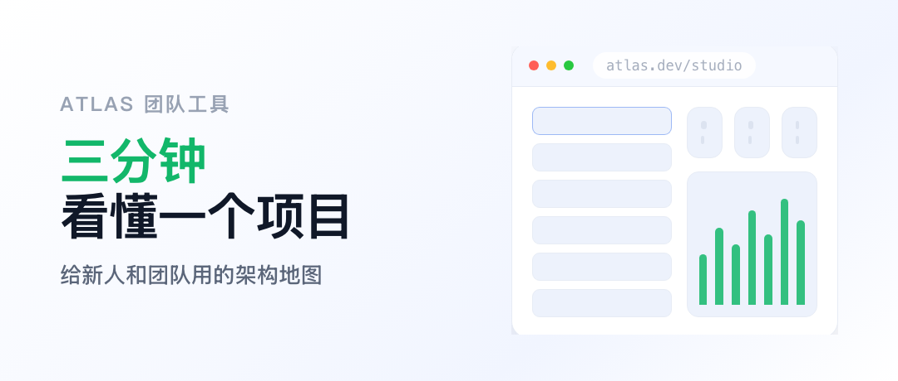
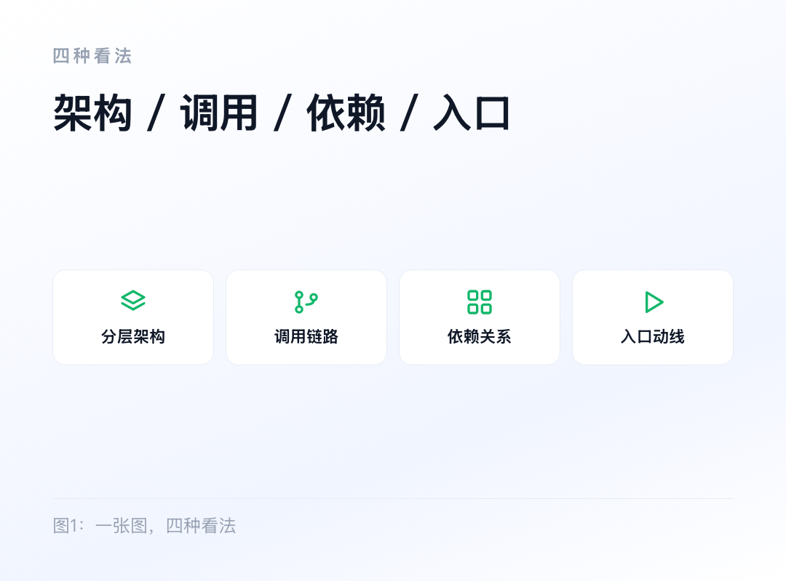
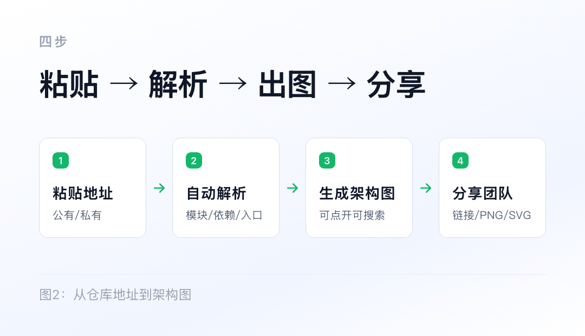
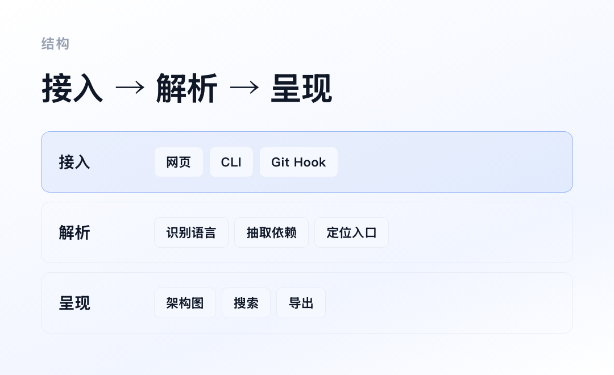

# 3 分钟看懂一个陌生项目，Atlas 帮你画出来

> 摘要：给团队和新人用的架构地图：导入仓库，自动生成能点开的架构图，新人也能 3 分钟上手。

新同事入职第一天，最常问的一句话是：这个项目到底是干嘛的、从哪看起？

文档往往过期，目录又陌生，最后只能追着老同事问，一问就是半小时，问的人累、答的人也累。

更麻烦的是，同一个功能，三个人可能给你三种说法——因为大家脑子里那张「项目地图」本来就不一样。

Atlas 想做的，就是把「问人」变成「看图」：导入仓库，自动生成一张能点开的架构图，全团队看同一张。

## 一、一个真实的新人场景

假设你今天加入一个前端团队，拿到一个几十万行的仓库。README 只有三行，文档目录停在两年前。

你想知道「登录流程经过哪些模块」，翻文件翻了二十分钟也没理清，最后还是去问坐旁边的老同事。

这时候，一张能点开的架构图，比任何文档都直接：点开「登录」，相关模块和调用链一目了然。

## 二、三分钟里发生了什么

把仓库地址粘进去，Atlas 会自动识别语言、抽取依赖、定位入口，然后生成架构图。整个过程在浏览器里完成，不用装插件，也不用改一行代码。

私有仓库可以授权后解析，团队里每个人看到的都是同一张最新的图，不会出现「你那份是上个月的」。

生成的图不仅能看，还能点、能搜：输入一个模块名，直接定位到它在图上的位置和它的上下游。

> 把「问人」变成「看图」，是对新人最友好的工程文化。

## 三、背后三层，各做一件事

Atlas 内部拆成三层：接入层负责把仓库拿进来，解析层负责把代码翻译成结构，呈现层负责把结构画成人能看懂的图。

这样的分层让它可以被部分复用：你只想用解析结果、接到自己的看板里，也完全没问题。

对团队来说，重点是「同一张图、同一个口径」，而不是每个工具各画一版。

## 四、团队可以怎么用

新人上手：入职第一天先看图，再决定从哪个模块开始读代码，少走弯路。

评审与交接：把架构图贴进评审文档和交接清单，谁负责哪块、改动影响谁，一目了然。

跨团队沟通：产品、测试也能看懂系统边界，很多会可以直接省掉。

- 新人上手：先看图再读代码
- 评审交接：图贴进文档
- 跨团队沟通：非技术也看得懂

## 五、它不做什么

Atlas 只做静态结构，不做运行时性能分析；图是「地图」，不是「体检报告」。

对高度动态、元编程很重的代码，识别可能不全，需要人工补全。把它当起点，而不是终点。

一句话：让每个新人都能自己看懂项目，团队就少了一半重复答疑。

---

**项目地址：**https://example.com/atlas
**在线体验：**https://atlas.dev/studio

> 关注「团队工具」，回复「上手」领取新人上手清单
