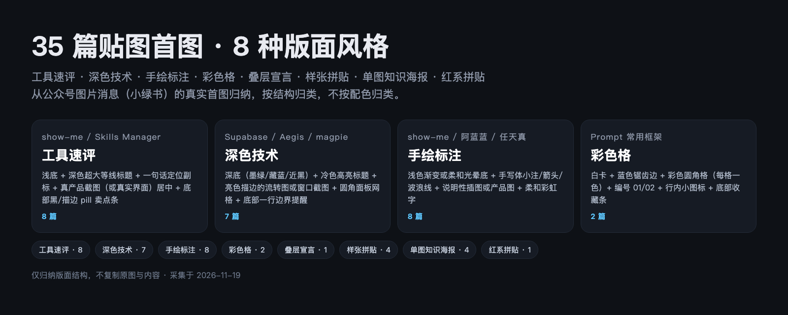

# 贴图首图参考（35 篇 · 8 种风格）

> 来源：用户提供的 35 条公众号贴图链接，采集于 2026-11-19。headless Chrome 以浏览器身份抓取正文，取出每篇首图与正文图，人工归纳版面结构；原图不复制进仓库（pin-red 保留一张作对照）。
> 只提炼结构规则，不复制内容；产出配图仍按 assets/tokens.css 令牌渲染。

下表是**每种风格的版面骨架**，选风格时按「赛道」查，不要按配色挑。

| 风格 | 代表账号 | 长什么样 | 适合哪类主题 |
|---|---|---|---|
| 工具速评 | show-me / Skills Manager | 浅底 + 深色超大等线标题 + 一句话定位副标 + 真产品截图（或真实界面）居中 + 底部黑/描边 pill 卖点条 | 开源工具、Skill、组件的首图 |
| 深色技术 | Supabase / Aegis / magpie | 深底（墨绿/藏蓝/近黑）+ 冷色高亮标题 + 亮色描边的流转图或窗口截图 + 圆角面板网格 + 底部一行边界提醒 | 后端、平台、基建类项目 |
| 手绘标注 | show-me / 阿蓝蓝 / 任天真 | 浅色渐变或柔和光晕底 + 手写体小注/箭头/波浪线 + 说明性插图或产品图 + 柔和彩虹字 | 工具、清单、网站推荐 |
| 彩色格 | Prompt 常用框架 | 白卡 + 蓝色锯齿边 + 彩色圆角格（每格一色）+ 编号 01/02 + 行内小图标 + 底部收藏条 | 清单、框架、模板 |
| 叠层宣言 | TANSOR LAB | 近黑底满屏产品/编辑器 + 上方叠一块宣言卡『绝妙想法，立刻实现！』+ 域名 pill + 橙色 CTA 按钮 + 像素风标签 | 有产品界面、要露出场景的地方 |
| 样张拼贴 | 350 种排版 · 阿蓝蓝 | 米白底 + 黑体大标题（一处下划线高亮）+ 说明段落 + 4 张竖版样张并排 + 样张下小字标签 + 底部标来源 | 作品集、图鉴、合集 |
| 单图知识海报 | AI Agent 完整架构 | 米白底 + 点线箭头把模块串成一个整体 + 主模块用彩色半透明块 + 侧栏多级小标题 + 底部总结句 | 原理图解、架构总览 |
| 红系拼贴 | Pin UI | 纯白点阵底 + 正红胶囊标签 + 红色 logo 气泡 + 品牌视觉块拼进标题 + 手写波浪下划线 + 倾斜卡片拼贴 + 底部 4 宫格要点 | 组件库、设计资源、有鲜明品牌色的新品 |

## 工具速评（tool-brief）

- 代表账号：show-me / Skills Manager
- 长什么样：浅底 + 深色超大等线标题 + 一句话定位副标 + 真产品截图（或真实界面）居中 + 底部黑/描边 pill 卖点条
- 适合：开源工具、Skill、组件的首图
- 版面骨架：1. kicker 一行小字标品类与许可；2. 主标题两行，第一行讲结论或疑问；3. 副标 ≤2 行讲给谁、做什么；4. 主区放真截图/真界面，占屏 40–50%；5. 底部 2 个 pill：最硬的背书 + 最实的决定项
- 本篇样本：[Graphify](https://mp.weixin.qq.com/s/-O18hh_aZ6SEdL2JmdUMow) · [CLI-Anything](https://mp.weixin.qq.com/s/r9BhbW2VxpfhvHfe4YYQ6A) · [Wake](https://mp.weixin.qq.com/s/hWZlr1F_R6aoR0yqCefohg) · [Hoppscotch](https://mp.weixin.qq.com/s/_rDuxlMUKtfUsHwNhwig3Q) · [book-to-skill](https://mp.weixin.qq.com/s/6yhOHXOktryPtRxNj8_WsA) · [Skills Manager](https://mp.weixin.qq.com/s/6mYEGt1J93ZLqQMJvjjkIA) · [FnCal](https://mp.weixin.qq.com/s/JqclFNkydrYEUr04e5QgKQ) · [design-extract](https://mp.weixin.qq.com/s/fk4-UHWiHVDe0jjjXbdrtA)

## 深色技术（dev-dark）

- 代表账号：Supabase / Aegis / magpie
- 长什么样：深底（墨绿/藏蓝/近黑）+ 冷色高亮标题 + 亮色描边的流转图或窗口截图 + 圆角面板网格 + 底部一行边界提醒
- 适合：后端、平台、基建类项目
- 版面骨架：1. 深底 + 右侧色光；2. 标题里只亮一个关键词；3. 主区用流程图或窗口截图做技术锚点；4. 2×2 能力面板，每格标题带一色；5. 底部一行『先了解：…』的边界说明，建立信任
- 本篇样本：[Supabase](https://mp.weixin.qq.com/s/dgiaU0yRHHvUd_HTYqZkhQ) · [muCommander](https://mp.weixin.qq.com/s/Qq7OM9S0eFBKdGeRsBudWg) · [可观测性工具](https://mp.weixin.qq.com/s/ACc3lvqM8h3wwxJm2nJk5w) · [GitNexus](https://mp.weixin.qq.com/s/X7JOXiIbLPf5bhXoleFagg) · [Aegis · Agent SLO](https://mp.weixin.qq.com/s/cDEq1osW4FxxPkUyNgvJew) · [B 端深色 UI](https://mp.weixin.qq.com/s/ylJUQq2x3E3bIYNFBh_4Zw) · [Magpie](https://mp.weixin.qq.com/s/vhXToHeIb5diCBx4HvfUyA)

## 手绘标注（annotated-illu）

- 代表账号：show-me / 阿蓝蓝 / 任天真
- 长什么样：浅色渐变或柔和光晕底 + 手写体小注/箭头/波浪线 + 说明性插图或产品图 + 柔和彩虹字
- 适合：工具、清单、网站推荐
- 版面骨架：1. 留白多、元素少；2. 2–4 处手写小注，指向画面里真正重要的位置；3. 标题一轮廓或渐变，副标一实心黑；4. 底部或右侧放 6 格 logo/图标墙
- 本篇样本：[show-me Skill](https://mp.weixin.qq.com/s/XMoevdJYCHhAD66vvN5dIg) · [answer-me-with-html](https://mp.weixin.qq.com/s/-gCYpUTpxpTiDJF_yGeIcQ) · [撒撒的糖盒](https://mp.weixin.qq.com/s/tLP5hH0DRXLcKciSYawrgg) · [diagram-design](https://mp.weixin.qq.com/s/jBboFB_WzaWB5MWo9Ht02Q) · [UI 设计干货](https://mp.weixin.qq.com/s/eTaRByOCxIRQdQe9WFvp-w) · [任天真AI设计室](https://mp.weixin.qq.com/s/ryLsLKE6YTtK7nMQLjdMqQ) · [灵感网站](https://mp.weixin.qq.com/s/bxWKYbFbba3Pkoo3kXxFsg) · [高端 Web 灵感](https://mp.weixin.qq.com/s/Lby15yLC6n75LuQRqpgJlw)

## 彩色格（color-grid）

- 代表账号：Prompt 常用框架
- 长什么样：白卡 + 蓝色锯齿边 + 彩色圆角格（每格一色）+ 编号 01/02 + 行内小图标 + 底部收藏条
- 适合：清单、框架、模板
- 版面骨架：1. 一格一个编号，颜色区分类别；2. 格子内部：标题 + 3–5 行要点；3. 顶部一句话公式横条；4. 底部『收藏起来，反复用』的 CTA 条
- 本篇样本：[Prompt 常用框架](https://mp.weixin.qq.com/s/y_-cGu8uMDmM5Y17JHeRQQ) · [UX/UI Prompt](https://mp.weixin.qq.com/s/HvFWXcr_M9kdtqUJzayrJg)

## 叠层宣言（bento-stack）

- 代表账号：TANSOR LAB
- 长什么样：近黑底满屏产品/编辑器 + 上方叠一块宣言卡『绝妙想法，立刻实现！』+ 域名 pill + 橙色 CTA 按钮 + 像素风标签
- 适合：有产品界面、要露出场景的地方
- 版面骨架：1. 界面铺底做质感；2. 顶部一块宣言卡压住界面；3. 一句话口号，动词收尾；4. 橙色/单一亮色 CTA 按钮
- 本篇样本：[TANSOR LAB](https://mp.weixin.qq.com/s/Au9cTRX_Peooi7QJQKXXeQ)

## 样张拼贴（layout-sample）

- 代表账号：350 种排版 · 阿蓝蓝
- 长什么样：米白底 + 黑体大标题（一处下划线高亮）+ 说明段落 + 4 张竖版样张并排 + 样张下小字标签 + 底部标来源
- 适合：作品集、图鉴、合集
- 版面骨架：1. 标题两行，第二行下划线；2. 一段 3 行说明讲清工具怎么用；3. 4 张样张等高并排，下配标签；4. 底部写清图源与出处
- 本篇样本：[阿蓝蓝](https://mp.weixin.qq.com/s/3yYB_bLz1GOYybKWbUnzBg) · [B 端工作台](https://mp.weixin.qq.com/s/etNY6AusjJqv8phTM3cSxg) · [BriRing](https://mp.weixin.qq.com/s/a-2kwkcuEFyOedNDjQwgiQ) · [教育培训 UI](https://mp.weixin.qq.com/s/o4HwflJ_85ORWJA_7FzNQA)

## 单图知识海报（diagram-poster）

- 代表账号：AI Agent 完整架构
- 长什么样：米白底 + 点线箭头把模块串成一个整体 + 主模块用彩色半透明块 + 侧栏多级小标题 + 底部总结句
- 适合：原理图解、架构总览
- 版面骨架：1. 先定一条主干（目标→步骤→产物）；2. 分支挂在主干两侧，用虚线与箭头；3. 颜色只区分层级或状态；4. 底部一句总结把整图讲完
- 本篇样本：[架构图解](https://mp.weixin.qq.com/s/-dX14HbTvYpVxvqdqoC_Jg) · [homelab-diagram](https://mp.weixin.qq.com/s/5U5wKVk3j4By0OuZLSHs9Q) · [知识图谱图解](https://mp.weixin.qq.com/s/EXkEIXCZ25pIMZaRwp0njA) · [Design skill](https://mp.weixin.qq.com/s/LtE4ZRUV_qjuQAvksA_fZA)

## 红系拼贴（pin-red）

- 代表账号：Pin UI
- 长什么样：纯白点阵底 + 正红胶囊标签 + 红色 logo 气泡 + 品牌视觉块拼进标题 + 手写波浪下划线 + 倾斜卡片拼贴 + 底部 4 宫格要点
- 适合：组件库、设计资源、有鲜明品牌色的新品
- 版面骨架：1. 左上 logo 气泡，右上页码 pill；2. 标题里用品牌图块当字（如 Pinterest 图标）；3. 波浪线标出标题落点；4. 倾斜卡片做产品拼贴；5. 底部 4 个图标 + 标题 + 一句话
- 本篇样本：[Pin UI](https://mp.weixin.qq.com/s/o0HY0ye_6iqGnoFmLuLB8Q)

## 全部 35 篇

| # | 标题 | 项目 / 账号 | 风格 | 链接 |
|---|---|---|---|---|
| 01 | 这个 Skill，专治 AI 废话！ | show-me Skill | 手绘标注 | [打开](https://mp.weixin.qq.com/s/XMoevdJYCHhAD66vvN5dIg) |
| 02 | 后端功能要拼几套？试试Supabase | Supabase | 深色技术 | [打开](https://mp.weixin.qq.com/s/dgiaU0yRHHvUd_HTYqZkhQ) |
| 03 | 一页 HTML 回答｜免费开源 | answer-me-with-html | 手绘标注 | [打开](https://mp.weixin.qq.com/s/-gCYpUTpxpTiDJF_yGeIcQ) |
| 04 | Graphify：把代码库变成可查询的知识图 | Graphify | 工具速评 | [打开](https://mp.weixin.qq.com/s/-O18hh_aZ6SEdL2JmdUMow) |
| 05 | 免费开源文件管家！FTP、NAS、压缩包都能用 | muCommander | 深色技术 | [打开](https://mp.weixin.qq.com/s/Qq7OM9S0eFBKdGeRsBudWg) |
| 06 | CLI-Anything 让任何软件妙变 CLI | CLI-Anything | 工具速评 | [打开](https://mp.weixin.qq.com/s/r9BhbW2VxpfhvHfe4YYQ6A) |
| 07 | 350 种构图，全给你编好号了 | 阿蓝蓝 | 样张拼贴 | [打开](https://mp.weixin.qq.com/s/3yYB_bLz1GOYybKWbUnzBg) |
| 08 | AI Agent 的完整架构，建议收藏 | 架构图解 | 单图知识海报 | [打开](https://mp.weixin.qq.com/s/-dX14HbTvYpVxvqdqoC_Jg) |
| 09 | grill-me：拷问想法，再动手开发 | 撒撒的糖盒 | 手绘标注 | [打开](https://mp.weixin.qq.com/s/tLP5hH0DRXLcKciSYawrgg) |
| 10 | 指标、日志、链路，在一个页面里查 | 可观测性工具 | 深色技术 | [打开](https://mp.weixin.qq.com/s/ACc3lvqM8h3wwxJm2nJk5w) |
| 11 | TANSOR LAB ｜ 探索实验室 | TANSOR LAB | 叠层宣言 | [打开](https://mp.weixin.qq.com/s/Au9cTRX_Peooi7QJQKXXeQ) |
| 12 | Wake 把 agent 会话收进一个窗口 | Wake | 工具速评 | [打开](https://mp.weixin.qq.com/s/hWZlr1F_R6aoR0yqCefohg) |
| 13 | 发个接口请求而已，Hoppscotch 不用登录 | Hoppscotch | 工具速评 | [打开](https://mp.weixin.qq.com/s/_rDuxlMUKtfUsHwNhwig3Q) |
| 14 | book-to-skill：技术书变技能 | book-to-skill | 工具速评 | [打开](https://mp.weixin.qq.com/s/6yhOHXOktryPtRxNj8_WsA) |
| 15 | homelab-diagram：画拓扑图 | homelab-diagram | 单图知识海报 | [打开](https://mp.weixin.qq.com/s/5U5wKVk3j4By0OuZLSHs9Q) |
| 16 | AI 工具越多 Skill 越乱：是时候统一收编了 | Skills Manager | 工具速评 | [打开](https://mp.weixin.qq.com/s/6mYEGt1J93ZLqQMJvjjkIA) |
| 17 | GitNexus — 让 Agent 看懂整个代码库 | GitNexus | 深色技术 | [打开](https://mp.weixin.qq.com/s/X7JOXiIbLPf5bhXoleFagg) |
| 18 | diagram-design：AI 也能画品牌级图表 | diagram-design | 手绘标注 | [打开](https://mp.weixin.qq.com/s/jBboFB_WzaWB5MWo9Ht02Q) |
| 19 | HTTP 202 之后，Agent 交付了吗？ | Aegis · Agent SLO | 深色技术 | [打开](https://mp.weixin.qq.com/s/cDEq1osW4FxxPkUyNgvJew) |
| 20 | 写代码或做内容，都有必要建「知识图谱」 | 知识图谱图解 | 单图知识海报 | [打开](https://mp.weixin.qq.com/s/EXkEIXCZ25pIMZaRwp0njA) |
| 21 | FnCal 日历更新啦 | FnCal | 工具速评 | [打开](https://mp.weixin.qq.com/s/JqclFNkydrYEUr04e5QgKQ) |
| 22 | UI 原型设计的概念 | UI 设计干货 | 手绘标注 | [打开](https://mp.weixin.qq.com/s/eTaRByOCxIRQdQe9WFvp-w) |
| 23 | B端深色UI怎么做出高级感？总结了6个关键点 | B 端深色 UI | 深色技术 | [打开](https://mp.weixin.qq.com/s/ylJUQq2x3E3bIYNFBh_4Zw) |
| 24 | 不会写提示词，这 8 个框架直接抄 | Prompt 常用框架 | 彩色格 | [打开](https://mp.weixin.qq.com/s/y_-cGu8uMDmM5Y17JHeRQQ) |
| 25 | B端工作台首页UI设计｜Web系统设计｜案例分享 | B 端工作台 | 样张拼贴 | [打开](https://mp.weixin.qq.com/s/etNY6AusjJqv8phTM3cSxg) |
| 26 | 给个网址，AI扒出整套设计！ | design-extract | 工具速评 | [打开](https://mp.weixin.qq.com/s/fk4-UHWiHVDe0jjjXbdrtA) |
| 27 | Vibe Coding必看，别再让AI凭感觉做动效了 | 任天真AI设计室 | 手绘标注 | [打开](https://mp.weixin.qq.com/s/ryLsLKE6YTtK7nMQLjdMqQ) |
| 28 | 如何为后台系统构建一个 Design skill | Design skill | 单图知识海报 | [打开](https://mp.weixin.qq.com/s/LtE4ZRUV_qjuQAvksA_fZA) |
| 29 | BriRing_APP风格设计 | BriRing | 样张拼贴 | [打开](https://mp.weixin.qq.com/s/a-2kwkcuEFyOedNDjQwgiQ) |
| 30 | UX/UI Prompt：给 AI 抄的界面零件 | UX/UI Prompt | 彩色格 | [打开](https://mp.weixin.qq.com/s/HvFWXcr_M9kdtqUJzayrJg) |
| 31 | 一个入口全接管，喂饱全端免费额度 | Magpie | 深色技术 | [打开](https://mp.weixin.qq.com/s/vhXToHeIb5diCBx4HvfUyA) |
| 32 | 前端UI设计师找灵感就看这8个网站 | 灵感网站 | 手绘标注 | [打开](https://mp.weixin.qq.com/s/bxWKYbFbba3Pkoo3kXxFsg) |
| 33 | 职业教育类网站UI设计｜教育培训｜灵感分享 | 教育培训 UI | 样张拼贴 | [打开](https://mp.weixin.qq.com/s/o4HwflJ_85ORWJA_7FzNQA) |
| 34 | 高端Web开发必上的8个灵感网站 | 高端 Web 灵感 | 手绘标注 | [打开](https://mp.weixin.qq.com/s/Lby15yLC6n75LuQRqpgJlw) |
| 35 | 推荐一个非常新的开源 UI 组件库 | Pin UI | 红系拼贴 | [打开](https://mp.weixin.qq.com/s/o0HY0ye_6iqGnoFmLuLB8Q) |

> 原图不随仓库分发：抓取时微信对非浏览器请求返回「环境异常」，需用浏览器 UA + data-src 取图；图源为 mmbiz.qpic.cn，下载需带 Referer。本仓库只保留 `pin-red` 一张作对照（`assets/style-cases/pin-red/`），其余仅记录结构。
