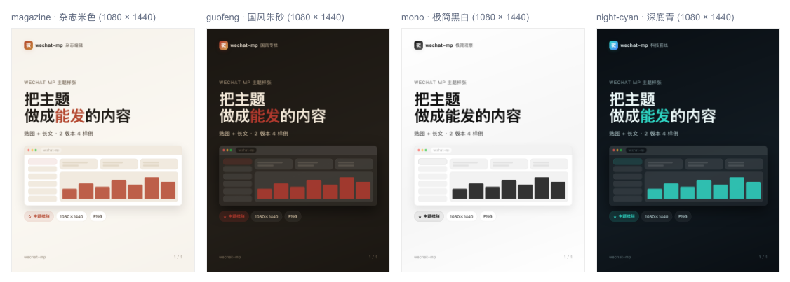

# 主题与风格（可选增强 · styles）

> 这是**可选增强**，用于扩展风格库；核心交付不依赖它。

当前内置 6 套主题：`.t-dark`（深色科技）/ `.t-light`（浅色清新）+ 4 套预设（magazine / guofeng / mono / night-cyan）。要加新主题，**只改令牌，不改组件**。

## 加一套主题的步骤

1. 在 [assets/tokens.css](../assets/tokens.css) 增加 `.t-<name>{ --bg1/--bg2/--bg3/--surface/--border/--text/--text-2/--text-3/--accent/... }`。
2. 需要专属背景纹理时，补一条 `.t-<name> .card .bg{...}`。
3. 在 [scripts/gen-specimens.mjs](../scripts/gen-specimens.mjs) 的 `themes` 里加一行，跑 `node scripts/gen-specimens.mjs`，样张会自动写入 `assets/style-specimens/`。
4. 在下面的表里登记，方向提案时从样张里选。

## 建议的 4 套预设（可直接抄色值）

| 名称 | 气质 | bg | surface | text | accent | 样张 |
|---|---|---|---|---|---|---|
| magazine（杂志米色） | 编辑感、纸感 | `#F7F3EC` | `#FFFFFF` | `#1F1B16` | `#B4472F` | [sheet-magazine.png](../assets/style-specimens/sheet-magazine.png) |
| guofeng（国风墨朱） | 传统、克制、深墨 | `#1B1712` | `rgba(255,255,255,.05)` | `#F2E8D8` | `#B23A2E` | [sheet-guofeng.png](../assets/style-specimens/sheet-guofeng.png) |
| mono（极简黑白） | 理性、技术 | `#FFFFFF` | `#F6F6F6` | `#111111` | `#111111` | [sheet-mono.png](../assets/style-specimens/sheet-mono.png) |
| night-cyan（深底青） | 科技、冷静 | `#0A0F14` | `#121B22` | `#EAF6F6` | `#2FD6C4` | [sheet-night-cyan.png](../assets/style-specimens/sheet-night-cyan.png) |

样张由 `node scripts/gen-specimens.mjs` 用真实渲染管线生成，不是色块示意。

## 规矩

- 正文对比度 ≥4.5:1，标签 ≥3:1。
- 一个方向只用一套强调色；别把两套主题的色混在一个版里。
- 加主题不是换皮：方向提案仍要求结构不同（见 [directions](directions.md)）。
